# Patchy Image Editor

A free, open-source image editor for Windows, macOS, Linux, and the browser.
Built with a focus on accurate PSD compatibility, keeping text, vectors, masks,
layer styles, and Smart Objects editable when working with layered Photoshop files.
Work in limited palettes without flattening your layers, bring in Affinity,
Krita, GIMP, OpenRaster, Paint.NET, and PDF artwork, and extend the editor with classic plug-ins
and JavaScript.

**[Download](#download)** · **[Try in your browser](https://www.patchyimageeditor.com)** · **[Features](#features)** · **[Full gallery](docs/screenshots.md)**

For bug reports and feature requests, please [open an issue](https://github.com/SethRobinson/Patchy/issues/new) or post in [Discussions](https://github.com/SethRobinson/Patchy/discussions). These are the best places to post because search engines can index them, helping others find the questions and answers.  Want to chat? Join [Seth's Discord](https://discord.gg/QwV5VaZ).

<a href="docs/images/screenshots/smart_filters.png">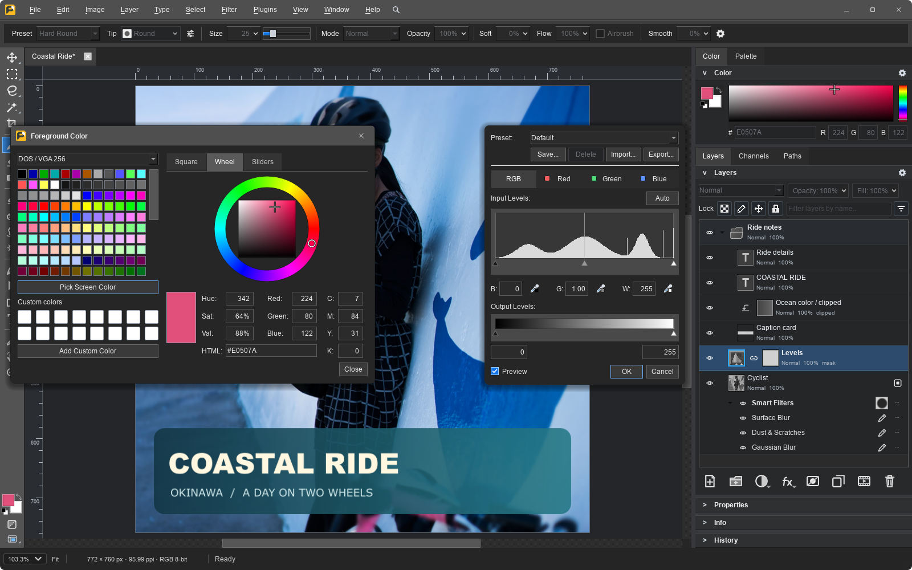</a>

*Designed to feel familiar if you're used to Photoshop's workflows and keyboard shortcuts.*

## Download

**Latest release: 1.26** · November 4, 2026 · [Release notes](#whats-new) · [All releases](https://github.com/SethRobinson/Patchy/releases)

Windows releases are code signed by Seth A. Robinson; the macOS app is signed and
notarized (Robinson Technologies Corporation); the Linux Flatpak repository is GPG
signed. Every release is published on the
[GitHub Releases page](https://github.com/SethRobinson/Patchy/releases) with SHA-256
checksums.

| Platform                  | Package                        | Download                                                                                                                             |
| ------------------------- | ------------------------------ | ------------------------------------------------------------------------------------------------------------------------------------ |
| Windows 10/11 (64-bit)    | Installer                      | [PatchyWindowsInstaller.exe](https://github.com/SethRobinson/Patchy/releases/latest/download/PatchyWindowsInstaller.exe) (112 MB)     |
| Windows 10/11 (64-bit)    | ZIP file (no installer)    | [PatchyWindowsNoInstaller.zip](https://github.com/SethRobinson/Patchy/releases/latest/download/PatchyWindowsNoInstaller.zip) (112 MB) |
| Windows 11 (ARM64)        | Installer                      | [PatchyWindowsArm64Installer.exe](https://github.com/SethRobinson/Patchy/releases/latest/download/PatchyWindowsArm64Installer.exe) (105 MB) |
| Windows 11 (ARM64)        | ZIP file (no installer)    | [PatchyWindowsArm64NoInstaller.zip](https://github.com/SethRobinson/Patchy/releases/latest/download/PatchyWindowsArm64NoInstaller.zip) (105 MB) |
| macOS 12+ (Apple Silicon) | DMG - drag to Applications     | [PatchyMacOS.dmg](https://github.com/SethRobinson/Patchy/releases/latest/download/PatchyMacOS.dmg) (117 MB)                           |
| Linux (x86_64)            | Flatpak, from our repository   | The [command below](#linux), or [com.rtsoft.patchy.flatpakref](https://rtsoft.com/flatpak/com.rtsoft.patchy.flatpakref)            |
| Linux (x86_64)            | Flatpak bundle (single file)   | [PatchyLinux.flatpak](https://github.com/SethRobinson/Patchy/releases/latest/download/PatchyLinux.flatpak) (49 MB)                   |
| Linux (x86_64)            | AppImage (Ubuntu 22.04+)       | [PatchyLinux.AppImage](https://github.com/SethRobinson/Patchy/releases/latest/download/PatchyLinux.AppImage) (95 MB, [details](#appimage)) |
| Any modern browser        | Nothing to install             | [patchyimageeditor.com](https://www.patchyimageeditor.com) or [rtsoft.com/patchy](https://www.rtsoft.com/patchy/)                    |

### Linux

Paste this into a terminal. It installs Patchy for your user from the Patchy Flatpak
repository and pulls the shared KDE runtime from Flathub. No root needed.

```sh
flatpak install --user https://rtsoft.com/flatpak/com.rtsoft.patchy.flatpakref
```

Patchy then updates with `flatpak update` or through your software center, and starts
from your application menu or with `flatpak run com.rtsoft.patchy`.

This needs the `flatpak` tool. Fedora and openSUSE desktops usually have it already. If
needed, install it first with `sudo apt install flatpak` (Ubuntu, Debian),
`sudo dnf install flatpak` (Fedora) or `sudo zypper install flatpak` (openSUSE).

If you already use flatpak system-wide, you can use `--system` in place of `--user`.
Patchy then reuses the runtime extensions you already have (graphics drivers, codecs)
instead of downloading them again. Installing that way may ask for an admin password.

The `.flatpakref` link in the table downloads a small file that a Flatpak-aware
software center (GNOME Software, KDE Discover) can open to install Patchy. Ubuntu has
none by default, and on Ubuntu 24.04 GNOME Software's Open button fails to start
Flatpak apps, so use the terminal command above instead.

The single-file bundle is the same build, for when you would rather download a file
first. Install it with `flatpak install --user PatchyLinux.flatpak`. It still fetches
the KDE runtime from Flathub, and it updates from the same repository afterwards.

My flatpak knowledge is limited, so I hope all this makes sense.  I hope to submit Patchy to Flathub eventually, but for now we have our own repository.

#### AppImage

`PatchyLinux.AppImage` is one file that runs without installing anything, on Ubuntu
22.04 or newer (or another distro from 2022 on: Debian 12, Fedora 36, Mint 21 and so on).
It updates itself, so keep it somewhere you can write to, such as `~/Applications`:

```sh
mkdir -p ~/Applications && cd ~/Applications
wget -O PatchyLinux.AppImage https://github.com/SethRobinson/Patchy/releases/latest/download/PatchyLinux.AppImage
chmod +x PatchyLinux.AppImage
./PatchyLinux.AppImage
```

(`curl -LO` works instead of `wget -O PatchyLinux.AppImage`.) You can also make it
executable from your file manager (Properties > Permissions, "Allow executing file as
program") and double-click it.

The AppImage needs the FUSE 3 tools and libraries (not `libfuse2`), which most desktops
already have. If it says it cannot mount itself, install it:

| Distro | Command |
| --- | --- |
| Ubuntu, Mint, Debian, Pop!_OS | `sudo apt install fuse3` |
| Fedora | `sudo dnf install fuse3` |
| openSUSE | `sudo zypper install fuse3` |
| Arch, Manjaro | `sudo pacman -S fuse3` |

Without FUSE (some containers and minimal systems), run it with
`./PatchyLinux.AppImage --appimage-extract-and-run`.

To add Patchy to your application menu, use an AppImage integration tool:
[Gear Lever](https://flathub.org/apps/it.mijorus.gearlever) (a Flatpak app: open the
AppImage with it), [AppImageLauncher](https://github.com/TheAssassin/AppImageLauncher)
(offers to integrate an AppImage the first time you open it),
[AM](https://github.com/ivan-hc/AM) (command line: `am --launcher ./PatchyLinux.AppImage`),
or [AppImage Manager](https://github.com/tunjayoff/appimagemanager).

When a new version is out, Patchy's update prompt can download it, replace the AppImage
file and start again (if the file sits in a folder you can write to; otherwise it offers
the download). AppImage tools such as Gear Lever or AppImageUpdate can also update it.
For AI control, the connector command is the AppImage file with the argument
`patchy-mcp` (Help > Set up AI Control shows the exact line). The AppImage opens HEIC
images through your distribution's libheif (Ubuntu and Debian: the `libheif1` package,
plus `libheif-plugin-libde265` on Ubuntu 24.04 and later); the Flatpak brings its own.
JPEG XR opens and saves through your distribution's jxrlib (Ubuntu and Debian: `libjxr0`;
Fedora: `jxrlib` from EPEL on RHEL-based systems); without it Patchy says what to install.
JPEG XR is not available in the Flatpak.

## Screenshots

See it in action.  Click an image for the full-size capture.

<table>
  <tr>
    <td valign="top" width="50%"><a href="docs/images/screenshots/layer_styles.png">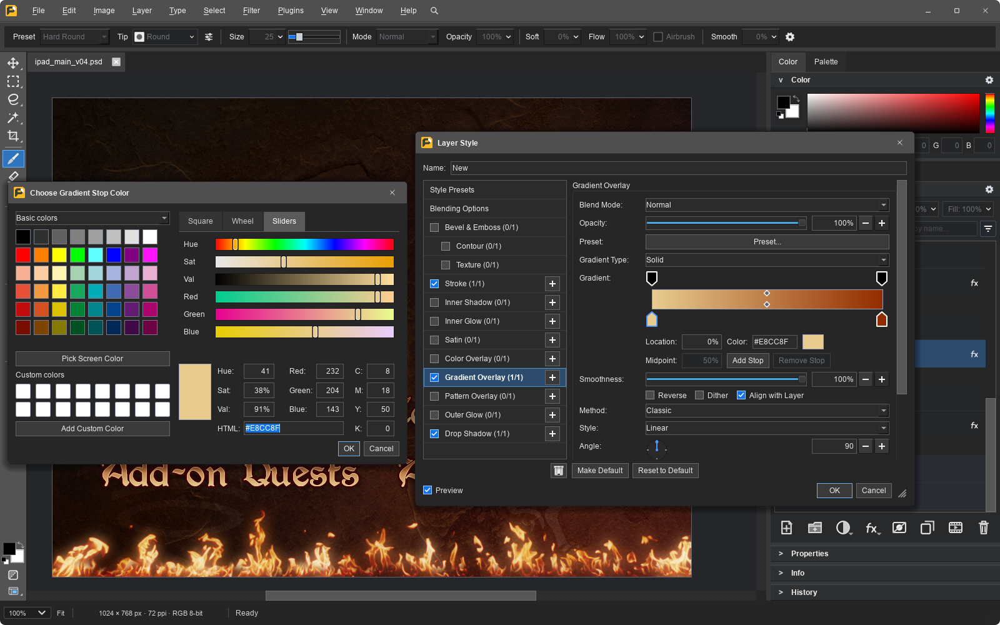</a><br><strong>Build up layer effects</strong><br>Layer styles with multiple effects, blending controls, and Photoshop-compatible presets.</td>
    <td valign="top" width="50%"><a href="docs/images/screenshots/plugin_kpt5.png">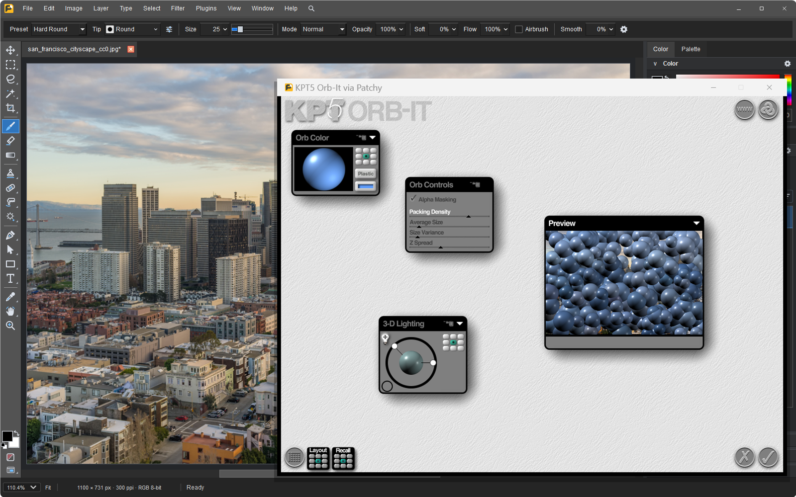</a><br><strong>Bring your old plug-ins</strong><br>Kai's Power Tools 5 running in its own window over Patchy. Classic 32-bit and 64-bit 8BF filters work on Windows.</td>
  </tr>
  <tr>
    <td valign="top" width="50%"><a href="docs/images/screenshots/object_select.png">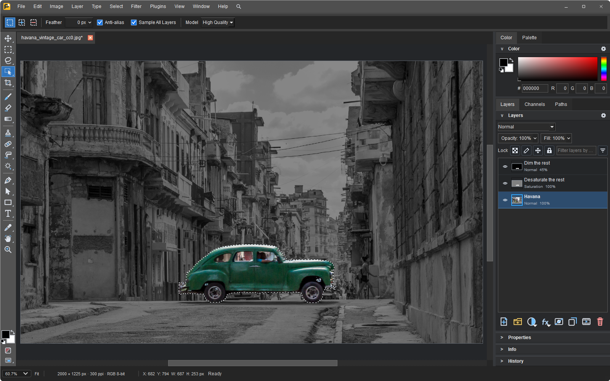</a><br><strong>Select the object, not the box</strong><br>Drag a loose box around anything and Object Selection picks out just the object. Runs on your CPU.</td>
    <td valign="top" width="50%"><a href="docs/images/screenshots/vector_tools.png">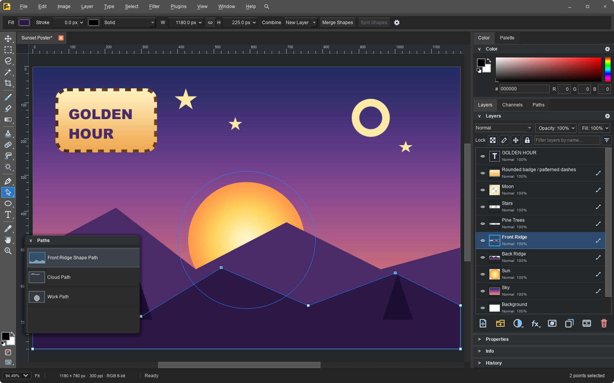</a><br><strong>Edit the paths</strong><br>Editable paths, gradient and pattern paint, dashed strokes, rounded corners, and a Paths panel.</td>
  </tr>
  <tr>
    <td valign="top" width="50%"><a href="docs/images/screenshots/warp_text.png">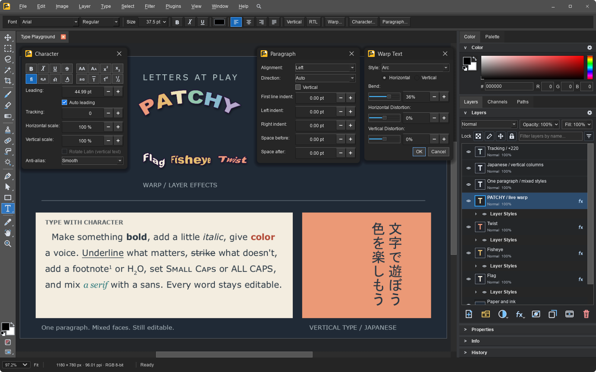</a><br><strong>Give type its own voice</strong><br>Warped text, mixed fonts and styles in one paragraph (underline, strikethrough, super and subscript, small caps), letter spacing, and vertical Japanese.</td>
    <td valign="top" width="50%"><a href="docs/images/screenshots/tilt_shift.png">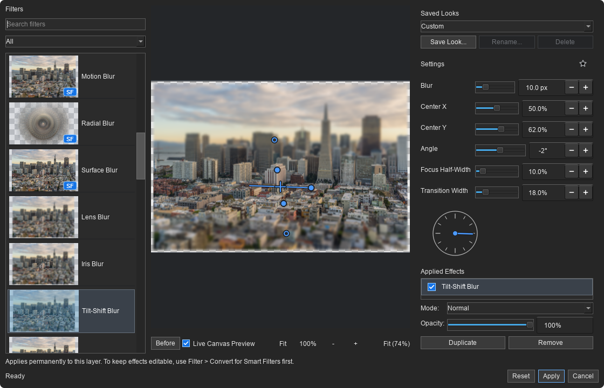</a><br><strong>Shape the focus</strong><br>Comes with many filters and a filter gallery, like Tilt-Shift Blur with live previews.</td>
  </tr>
  <tr>
    <td valign="top" width="50%"><a href="docs/images/screenshots/artboards.png">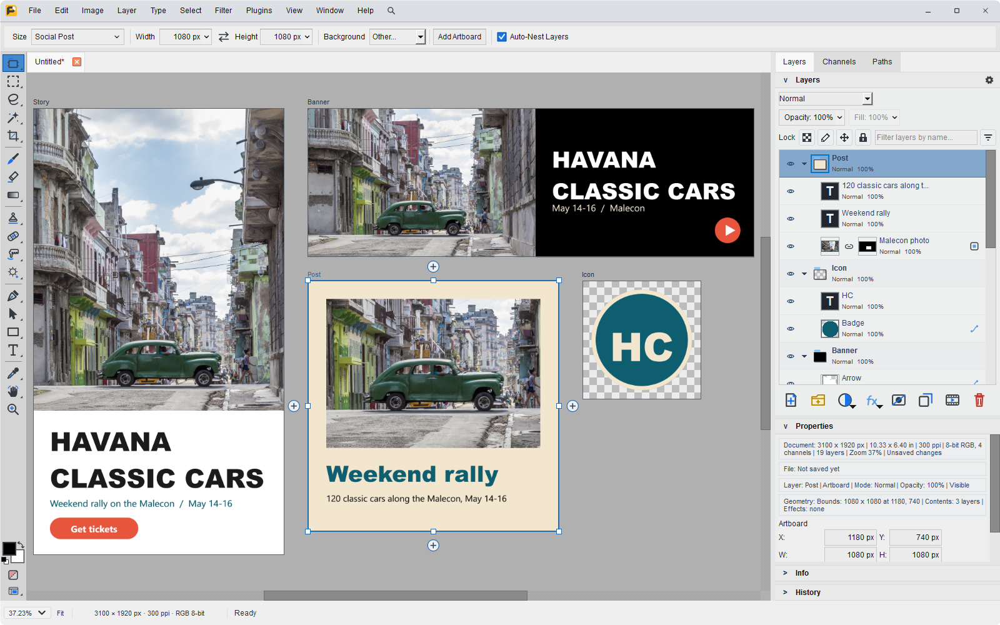</a><br><strong>Every size in one document</strong><br>Artboards keep a story, banner, post and icon side by side, each with its own size and background. Export them to separate files or PDF pages. This screenshot uses the Light theme.</td>
    <td valign="top" width="50%"><a href="docs/images/screenshots/gmic.png">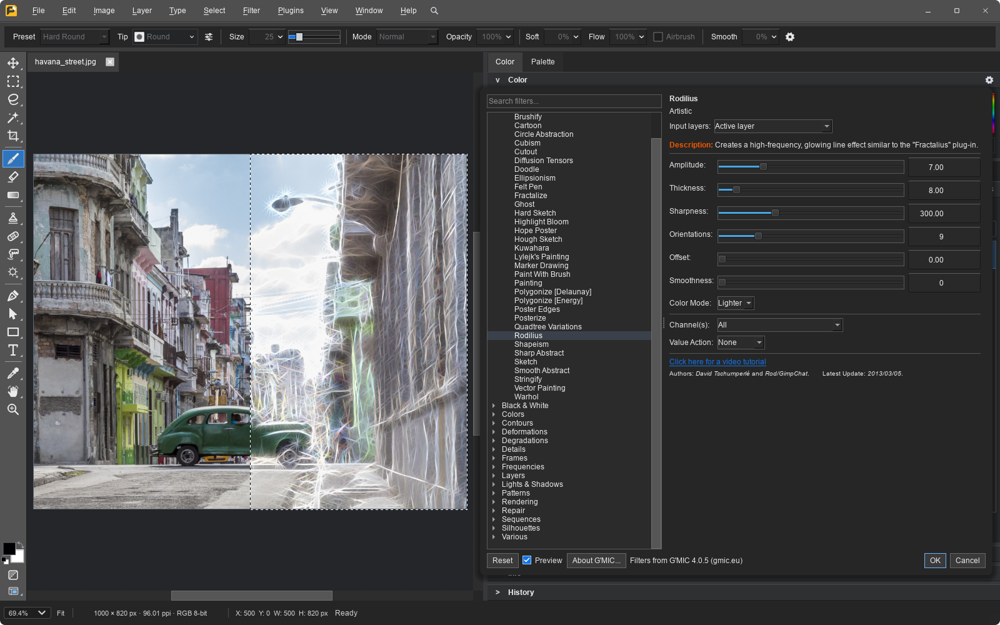</a><br><strong>Nearly 400 G'MIC filters</strong><br>Browse the G'MIC library, adjust the settings, and watch the result render live on your canvas. Here Rodilius runs inside a selection, with the original photo on the left.</td>
  </tr>
  <tr>
    <td valign="top" width="50%"><a href="docs/images/screenshots/web_export.png">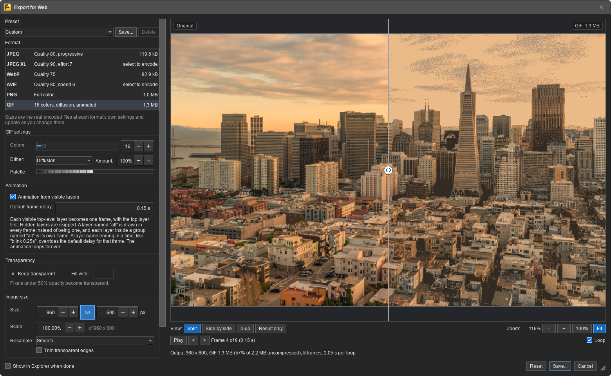</a><br><strong>Export for the web</strong><br>Compare JPEG, WebP, AVIF, JPEG XL, PNG and GIF by their real encoded sizes, with a split view against the original. Layers can become an animated GIF that plays in the preview.</td>
    <td valign="top" width="50%"><a href="docs/images/screenshots/layered_import.png">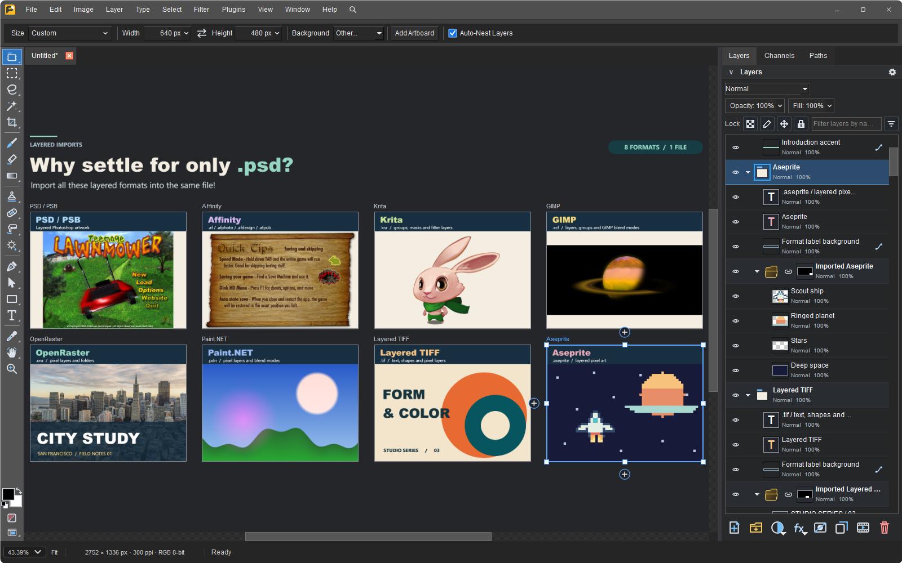</a><br><strong>Eight layer formats, one document</strong><br>PSD/PSB, Affinity, Krita, GIMP, OpenRaster, Paint.NET, layered TIFF, and Aseprite artwork, each imported onto its own artboard with its layer stack intact. Editable SVG and PDF imports are available too. See the <a href="docs/features.md#layered-format-interchange">format support and limitations</a>.</td>
  </tr>
</table>

[See the full gallery](docs/screenshots.md) for painting, palette mode, seamless textures, Camera Raw, long shadows, scripting, and more.

## Features

| Workflow | What you get |
| --- | --- |
| **Layered Photoshop files** | PSD and PSB, editable text, groups, masks, clipping, blend modes, and layer styles. |
| **Pixel art and game assets** | Paint in a fixed palette while keeping layers, text, and effects editable. Use retro or custom palettes, named colors, and indexed PNG/BMP export, alongside seamless tiling, sprite sheets, image sequences, DDS textures, and animated GIF/WebP/PNG. |
| **Layered formats from other editors** | Import Affinity (.af, .afphoto, .afdesign, .afpub) with supported text, vectors, masks, adjustments, and effects; open Krita (.kra) and GIMP (.xcf) documents with their groups, masks, and blend modes; open Paint.NET (.pdn) with its pixel layers and blend modes; open and save OpenRaster (.ora), layered TIFF, and Aseprite files. [Format support and limitations](docs/features.md#layered-format-interchange). |
| **PDF documents** | Import pages as editable text, vectors, and images on desktop; export single or multi-page PDFs with editable or flattened content. |
| **Non-destructive editing** | Adjustment layers, embedded and linked Smart Objects, editable Smart Filters, and shared filter masks. |
| **Paint and retouch** | Pressure-aware brushes, Mixer Brush, stroke smoothing, healing, cloning, Patch, Red Eye, Remove Object, Liquify, and selections, including Object Selection that picks out an object from a dragged box. |
| **Text and vectors** | Rich and vertical text, paragraph controls, Warp Text, Pen paths, shape layers, vector masks, SVG, and image tracing. |
| **Photos and print** | 16-bit and 32-bit (HDR) editing, Camera Raw development, HEIC/HEIF, AVIF, JPEG XL, JPEG 2000, OpenEXR and Radiance HDR, plus CMYK proofing and CMYK JPEG, TIFF, and PDF export for print. |
| **Extend your workflow** | The G'MIC filter library (nearly 400 filters with live preview, desktop), Last Filter to repeat any filter, classic 32-bit and 64-bit Photoshop filter plug-ins on Windows (64-bit on Linux), a built-in JavaScript editor, batch processing, command-line tools, and local MCP control. |

Patchy's C++ foundation makes these integrations more straightforward: we can build
on established C and C++ libraries such as G'MIC and implement classic Photoshop
plug-in interfaces directly.

[Full feature list and format support](docs/features.md) · [Scripting guide](scripts/bundled/scripting-guide.md) · [AI control setup](docs/ai-control.md)

**Local by design.** No telemetry, tracking, or uploads of your images. The browser build
runs the same editor locally through WebAssembly. Desktop builds have more memory
available and add printing, scanner/camera import, and command-line automation.
Optional update checks contact GitHub, as do the one-click updates (Windows and the Linux AppImage) and Object Selection's High Quality model, each downloaded only if you ask for it. Twelve interface languages, dark and light
schemes, and importable themes are included.

## Platform support

The desktop and browser builds share the editor, with these differences:

| Capability | Windows | macOS | Linux | Browser |
| --- | --- | --- | --- | --- |
| Available build | x64, ARM64 | Apple Silicon | x86-64, ARM64, Flatpak / AppImage | WebAssembly |
| 8-bit and 16-bit editing | Yes | Yes | Yes | Yes |
| 32-bit HDR editing | Yes | Yes | Yes | Opens converted to 16-bit |
| PSD/PSB, Affinity, Krita, GIMP, OpenRaster, Paint.NET, layered TIFF, Aseprite | Yes | Yes | Yes | Yes |
| PDF import / export | Both (ARM64: export only) | Both | Both | Export only |
| G'MIC Filter Library | Yes | Yes | Yes | No |
| Photoshop filter plug-ins (.8bf) | 32-bit and 64-bit | No | 64-bit, via bundled [Raven](https://useraven.org) | No |
| AVIF import / export | Both | Both | Both | No |
| JPEG XR import / export | Both | No | Both, with the system's jxrlib | No |
| HEIC/HEIF import | With OS codecs | With OS decoder | With system decoder | With browser HEVC support |
| Printing | Yes | Yes | Yes | No |
| Scanner / camera acquisition | Both, via WIA | Scanners | Both, via SANE and gphoto2 | No |
| Built-in JavaScript editor | Yes | Yes | Yes | Yes |
| Command line and local MCP connector | Yes | Yes | Yes | No |

Format support does not imply every source feature stays editable; see the
[format limits](docs/features.md#layered-format-interchange) and
[current limitations](docs/features.md#current-status). PDF import requires Qt PDF
when building a custom desktop version. HEIC/HEIF availability depends on the
[installed decoder](docs/heif.md). The browser build also has tighter memory limits.

## PSD compatibility, measured

In the [October 29, 2026 Testy v2 run](https://www.rtsoft.com/testy/2026-10-29/),
Patchy opened **all 309 files** of the psd-tools test collection, and Photoshop
reopened **every Patchy save** with **all 43 text objects, 183 adjustment layers,
172 Smart Objects, and 181 live effects** kept. Patchy's perceptual render match
was **98.7%**, with 299 files within 10% of Photoshop's pixels, and its Photoshop
text score was **97.3%**, both the highest of the six programs tested against
Photoshop's reference, using a Patchy 1.21 development build (commit `25822a64`).

Testy v2 scores each program on what it draws itself: the baked pixels Photoshop
stores for text, shapes, fills, and Smart Objects are removed first. That is
stricter than the August run, so the two sets of numbers are not comparable.

These are dated, corpus-specific results. The linked report has every file's
renders and difference maps for all seven columns. Read the
[full comparison and methodology](docs/psd-compatibility-benchmark.md) for the
tables, per-folder results, scoring rules, and limitations.

**Know the limits:** editing is RGB at 8, 16, or 32 bits per channel (the browser
build stops at 16). CMYK work is proofing and export: CMYK Proof mode shows the print
colors and saves CMYK JPEG, TIFF, and PDF, but pixels stay RGB. Lab and the other color
modes convert to RGB on open, and there is no GPU acceleration. Unsupported Smart Filters can remain preview-locked,
and Affinity import has format-specific limitations. See [current compatibility](docs/features.md#current-status).

## What's New

### 1.26 - November 4, 2026

- Content-Aware Move: a new tool in the healing flyout moves a selected object and fills the spot it left, or copies it with Extend, with Feather, Anti-alias, a Current Layer or New Layer destination, and an Object Selection option that turns a rough outline into the object inside it; Patch tool drags show only the outline ([issue 599](https://github.com/SethRobinson/Patchy/issues/599), [issue 369](https://github.com/SethRobinson/Patchy/issues/369))
- Selections: Select > Transform Selection reshapes the selection outline, Select > Smooth and Select > Feather are new (also `selection.smooth` and `selection.feather` for scripts), and dragging a selection is much faster ([issue 323](https://github.com/SethRobinson/Patchy/issues/323), [issue 614](https://github.com/SethRobinson/Patchy/issues/614), [issue 603](https://github.com/SethRobinson/Patchy/issues/603))
- Text and shapes: Type > Convert to Shape and Create Work Path build shapes and paths from text's glyph outlines ([issue 598](https://github.com/SethRobinson/Patchy/issues/598)); Merge Shapes keeps separate shapes in the merged shape with their points, and the new Split Shapes command takes them apart again ([issue 587](https://github.com/SethRobinson/Patchy/issues/587)); box text hides lines that run past its frame, also after the edit ends ([issue 621](https://github.com/SethRobinson/Patchy/issues/621))
- Layer Style: a smaller, resizable dialog with one label column, color swatch rows, round angle dials for angle and altitude, Blend If in Blending Options, a Style Presets grid, and Make Default and Reset to Default ([issue 606](https://github.com/SethRobinson/Patchy/issues/606), [issue 618](https://github.com/SethRobinson/Patchy/issues/618))
- Menus: right-click menus on the canvas for transforms, crop, text editing and the Hand tool, with Free Transform and Transform Selection on the selection menu ([issue 323](https://github.com/SethRobinson/Patchy/issues/323)); the File menu groups Place and Metadata in submenus, with Revert under Save As ([issue 619](https://github.com/SethRobinson/Patchy/issues/619)); Place dialogs remember their folder, and Edit Contents offers Edit in Default App for SVG and similar contents ([issue 617](https://github.com/SethRobinson/Patchy/issues/617), [issue 620](https://github.com/SethRobinson/Patchy/issues/620))
- Speed: slider drags in dialogs stay responsive on large images ([issue 601](https://github.com/SethRobinson/Patchy/issues/601)), the Clone Stamp and Healing Brush keep up at large brush sizes ([issue 597](https://github.com/SethRobinson/Patchy/issues/597)), and color picker drags no longer lag ([issue 609](https://github.com/SethRobinson/Patchy/issues/609))
- Also: the Gradient tool has a Style list with Angle, Reflected and Diamond ([issue 610](https://github.com/SethRobinson/Patchy/issues/610)); GIMP .xcf files open with their layer effects applied through GEGL ([issue 616](https://github.com/SethRobinson/Patchy/issues/616)); Preferences > Units & Grids sets the zoom where the pixel grid appears ([issue 600](https://github.com/SethRobinson/Patchy/issues/600)); duplicating the Background makes an ordinary unlocked layer ([issue 604](https://github.com/SethRobinson/Patchy/issues/604)); double-clicking a fill layer's row or badge opens its settings ([issue 607](https://github.com/SethRobinson/Patchy/issues/607), [issue 582](https://github.com/SethRobinson/Patchy/issues/582)); Tab moves between fields in non-modal dialogs instead of hiding the panels ([issue 608](https://github.com/SethRobinson/Patchy/issues/608)); options bar dropdowns open below their box ([issue 613](https://github.com/SethRobinson/Patchy/issues/613)); the Marquee options bar hides its size fields when Style is Normal ([issue 602](https://github.com/SethRobinson/Patchy/issues/602)); the Clone Source popup hides the rows the Healing Brush does not use ([issue 596](https://github.com/SethRobinson/Patchy/issues/596), [issue 574](https://github.com/SethRobinson/Patchy/issues/574)); the save prompt names the file ([issue 605](https://github.com/SethRobinson/Patchy/issues/605)); the Remove Object dialog grows with its status text ([issue 612](https://github.com/SethRobinson/Patchy/issues/612)); tidier preset rows in Levels, Curves and Hue/Saturation, and OK buttons as wide as Cancel in Fill, Lock Layers and Select > Modify ([issue 588](https://github.com/SethRobinson/Patchy/issues/588), [issue 589](https://github.com/SethRobinson/Patchy/issues/589), [issue 592](https://github.com/SethRobinson/Patchy/issues/592), [issue 575](https://github.com/SethRobinson/Patchy/issues/575), [issue 544](https://github.com/SethRobinson/Patchy/issues/544), [issue 614](https://github.com/SethRobinson/Patchy/issues/614))

### 1.25 - November 3, 2026

- Companion apps: Plugins > Companions lists the companion apps installed in its folder, starts them, and shows a Quit entry while one runs. A companion works on the open document while you keep using Patchy's own tools. This prepares for [OpenFill](https://github.com/beckettharriman/openfill) (local generative fill through ComfyUI): OpenFill's Patchy support still has to be accepted by the OpenFill project, so no companion is available yet. Up to four companions and AI assistants can attach at once, and scripts gain selection and layer masks, composite pixels, PNG file reading and writing, and Canvas Size anchors
- GEGL filters: Filter > GEGL Filters offers 117 filters from Patchy's own build of GEGL (blurs, artistic, distortions, noise, light and shadow, rendering and more) in Patchy's filter dialog with a live preview, at 8, 16 and 32 bits, and from scripts. Each dialog credits GEGL; the source of the bundled GEGL is published with every release as PatchyGeglSources.zip ([issue 567](https://github.com/SethRobinson/Patchy/issues/567))
- Adjustments: Hue/Saturation, Levels, Curves, Color Balance and Black & White presets can be saved, deleted, imported and exported (.ahu, .alv, .blw), with shipped Hue/Saturation and Levels presets; Levels has eyedroppers, Color Balance has tabs and Reset, Curves an Input/Output column, Hue/Saturation colored tracks, Reset and edited-range asterisks, and Preview sits on the OK line ([issue 588](https://github.com/SethRobinson/Patchy/issues/588), [issue 589](https://github.com/SethRobinson/Patchy/issues/589), [issue 591](https://github.com/SethRobinson/Patchy/issues/591), [issue 592](https://github.com/SethRobinson/Patchy/issues/592), [issue 528](https://github.com/SethRobinson/Patchy/issues/528))
- Fill and fill layers: the Fill dialog has an Opacity slider and Content-Aware contents with Add to New Layer ([issue 575](https://github.com/SethRobinson/Patchy/issues/575)); the Gradient tool's Fill Layer mode drags out a Gradient Fill layer or redraws the selected one, and fill layers no longer act as shapes: their thumbnail opens the fill settings ([issue 580](https://github.com/SethRobinson/Patchy/issues/580)); Shape Appearance selects the layer's gradient preset, previews foreground and background gradients live and has Manage... buttons for the Gradient Manager ([issue 578](https://github.com/SethRobinson/Patchy/issues/578), [issue 579](https://github.com/SethRobinson/Patchy/issues/579), [issue 581](https://github.com/SethRobinson/Patchy/issues/581), [issue 582](https://github.com/SethRobinson/Patchy/issues/582), [issue 552](https://github.com/SethRobinson/Patchy/issues/552)); options bar stroke edits skip fill layers ([issue 583](https://github.com/SethRobinson/Patchy/issues/583)); the Stroke Presets manager lists dash and gap values, duplicates presets and edits saved ones ([issue 557](https://github.com/SethRobinson/Patchy/issues/557))
- Text: the Character dialog adds ligature, contextual alternate, discretionary ligature, swash, stylistic alternate and titling toggles, kept in PSD files ([issue 346](https://github.com/SethRobinson/Patchy/issues/346)); the font list's Recent line is easier to see, its filter lists scroll, and Enter stays in the list ([issue 569](https://github.com/SethRobinson/Patchy/issues/569), [issue 570](https://github.com/SethRobinson/Patchy/issues/570))
- Color panel: a hex field and R, G and B boxes under the Hue Cube ([issue 577](https://github.com/SethRobinson/Patchy/issues/577)); a right-click picks the background color ([issue 576](https://github.com/SethRobinson/Patchy/issues/576), [pull request 590](https://github.com/SethRobinson/Patchy/pull/590), thanks [softwaregames1](https://github.com/softwaregames1))
- Keys: Search Commands opens with Ctrl+F and shows descriptions as tooltips ([issue 554](https://github.com/SethRobinson/Patchy/issues/554)); F1 opens Patchy Help, F12 File > Revert, Tab hides the panels, and Home, End, Page Up and Page Down scroll the view ([issue 584](https://github.com/SethRobinson/Patchy/issues/584))
- Also: Export for Web has a 4-up view, a View and Zoom row and quality buttons ([issue 571](https://github.com/SethRobinson/Patchy/issues/571)); Merge Shapes merges only shapes that overlap ([issue 587](https://github.com/SethRobinson/Patchy/issues/587)); Shift-click in the Layers panel selects from the last clicked layer ([issue 594](https://github.com/SethRobinson/Patchy/issues/594)); Fit on Screen leaves a 10 px margin ([issue 585](https://github.com/SethRobinson/Patchy/issues/585)); dialogs shown while a file opens wait until its tab is fitted ([issue 593](https://github.com/SethRobinson/Patchy/issues/593)); Photocraft's Blend If settings open ([issue 586](https://github.com/SethRobinson/Patchy/issues/586)); the Clone Source popup has a Clear button ([issue 574](https://github.com/SethRobinson/Patchy/issues/574)); the selection stays editable while a filter dialog is open; the Lock Layers dialog shows its whole title ([issue 544](https://github.com/SethRobinson/Patchy/issues/544)); 00 sets 0% opacity and flow for painting tools ([issue 562](https://github.com/SethRobinson/Patchy/issues/562))

[Older releases](RELEASE-HISTORY.md)

## Photoshop plug-ins (.8bf)

Choose **Plugins > Open Plug-ins Folder**, copy your `.8bf` files and their supporting
files into it, then choose **Plugins > Rescan Plug-in Folders**. Both 32-bit and 64-bit
filters appear under **Plugins > Legacy Photoshop Plug-ins** on Windows. On Linux, 64-bit
filters run inside [Raven](https://useraven.org), which Patchy bundles (not in the Flatpak).

Filters run on the active pixel layer, respect the selection, and apply as one undoable
step. A separate helper isolates plug-in crashes. Plug-ins still run with your user
permissions, so install only ones you trust. KPT and other formerly full-screen filters
get a bounded, movable window. [Plug-in details](docs/plugins.md).

## Building it yourself

See [build instructions](docs/building.md) for the core, Qt desktop app, macOS, Linux,
and Windows packaging. On Linux, check out the Raven submodule first
(`git submodule update --init third_party/raven`) so the build includes .8bf plug-in support. Contributors and automation tools should read [AGENTS.md](AGENTS.md) first.

## License

Patchy is released under the MIT License. Third-party runtime notices are tracked in `NOTICE-THIRD-PARTY.md`.

## Trademark Notice

Adobe, Illustrator, and Photoshop are either registered trademarks or trademarks of Adobe in the United States and/or other countries. Patchy is an independent project and is not authorized, endorsed, or sponsored by Adobe. References to Photoshop, its file formats (PSD, Smart Objects, Smart Filters) and its plug-in format (8BF) are only there to describe compatibility and to label a Layers button arrangement.

Affinity is a trademark of Canva and its subsidiary Serif (Europe) Ltd. Patchy is not affiliated with, authorized, endorsed, or sponsored by Canva or Serif; Affinity is named only to describe which files Patchy can import and to label a Layers button arrangement.

All other product and company names, including Aseprite, GIMP, Kai's Power Tools, Krita, Windows, macOS, and Linux, are trademarks of their respective owners. They are used only to identify file formats, plug-ins, platforms and Layers button arrangements, and no endorsement is implied.

## AI Disclosure

This project was developed with significant assistance from AI tools.  I mean, you can still blame me (Seth) for bugs, but I just wanted to mention it.

Note:  All included textures/materials are real images taken by humans, not AI generated

## Missing features / contributions?

AI has reached the point where you can use your favorite AI agent to add the missing feature you want.

Just give it the link to this repo and tell it "read AGENTS.md and add feature X to this project".  It will read the code, read the tests, and add the feature.

I mean, that's kind the power of open source, amplified.

Whatever AI you use (the smarter the better), tell it (or more likely, it's reading this right now) to read AGENTS.md before doing anything else. It contains the build and repository-wide rules, then routes feature work to the relevant document under `docs/`.

There are thousands of regression and benchmarking tests. AGENTS.md links agents to the testing guide that explains how to select and run them.  Due to the size of some of the test files I use they aren't all included, it will skip tests that require missing files.\
\
I probably don't want any major features coming from outside, as there are wrong and right ways to do things, some of it a bit subjective. Remember, you can always go crazy in your own fork, have some fun!\
\
If you have a bug fix or feature you think fits this project's scope please open an issue or tweet/etc at me.  If you want to submit a pull request, please look at the actual code and fully TEST IT YOURSELF before submitting, and if possible include screenshots of the actual changes so it's clear what you're doing.  If you're using AI, use a good one (Fable/Astra+ class), we don't want barely working slop.

Don't trust AI to create and submit PRs with no oversight, I'll delete ones that have too much AI smell.  Smell human.  This is starting to sound weird but you know what I mean.

## Independent development and compatibility

Patchy is an independently developed image editor. Our goal is to build something powerful, fast, free of unnecessary bloat, and ultimately a tool that fits what I'm doing, especially for game-dev use cases. Recreating Photoshop feature for feature is not the goal.

Our PSD compatibility work uses publicly available format documentation and observations of files and rendered output produced by a licensed copy of Photoshop. We have not decompiled or disassembled Photoshop. Patchy also implements the legacy 8BF plug-in interface for interoperability, using its own declarations without copying Adobe SDK code. This compatibility work helps people keep their documents editable and use existing plug-ins across applications.

We also take patents seriously. Some features are deliberately limited or omitted because of patent concerns. For example, Quick Select calculates the selection when you finish a stroke instead of updating it continuously as you paint. Our [development constraints](docs/legal-constraints.md) document these boundaries, which we revisit as relevant patents expire or our research changes.

## Credits

Created by Seth A. Robinson - [Homepage](https://www.rtsoft.com/) | [Blog](https://www.codedojo.com/) | [Twitter](https://twitter.com/rtsoft) | [Bluesky](https://bsky.app/profile/rtsoft.com) | [Mastodon](https://mastodon.gamedev.place/@rtsoft)

Incredible people who donated suggestions, bug reports, and code: [mcapogna](https://github.com/mcapogna), [csbun](https://github.com/csbun), [ifloppy](https://github.com/ifloppy), [lucastucious](https://github.com/lucastucious), [softwaregames1](https://github.com/softwaregames1), [c-sanchez](https://github.com/c-sanchez), [egofree71](https://github.com/egofree71), [PorkingMane](https://github.com/PorkingMane), [alexanderadam](https://github.com/alexanderadam), [danielmigueltejedor](https://github.com/danielmigueltejedor), [ProShi](https://github.com/ProShi), [Kevdoy](https://github.com/Kevdoy), [popkc3](https://github.com/popkc3), [WinterTreat](https://github.com/WinterTreat), [jackpini](https://github.com/jackpini), [fivetenth](https://github.com/fivetenth), [revae](https://github.com/revae), [RDR77](https://github.com/RDR77), [Oppa-YA](https://github.com/Oppa-YA), [YuFu-Onship](https://github.com/YuFu-Onship), [malnaanah](https://github.com/malnaanah), [CHJ85](https://github.com/CHJ85), [DavidLee1115](https://github.com/DavidLee1115), [philipzae](https://github.com/philipzae), [Uthopik](https://github.com/Uthopik), and [spgrhy-lab](https://github.com/spgrhy-lab)

Photo "akiko_cycling_okinawa" (seen in the screenshots) by Seth A. Robinson
