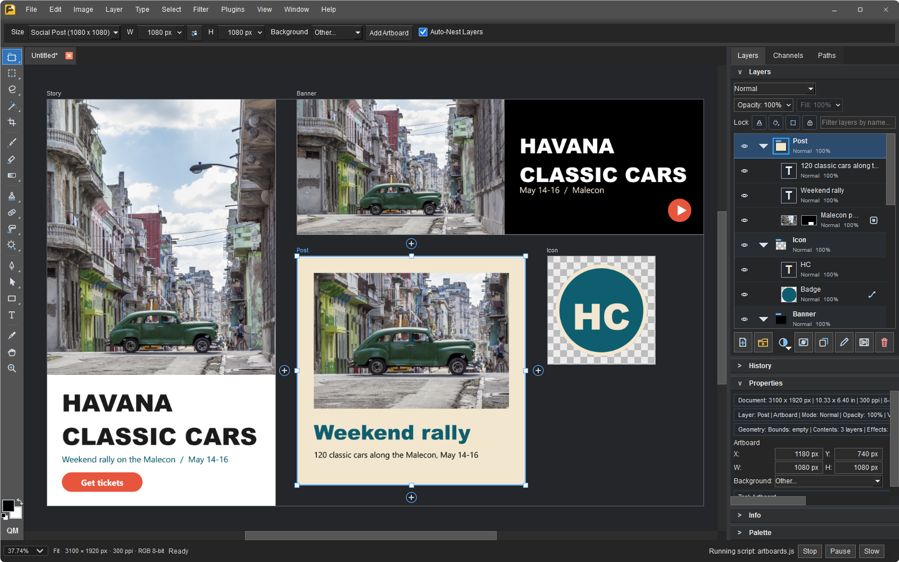
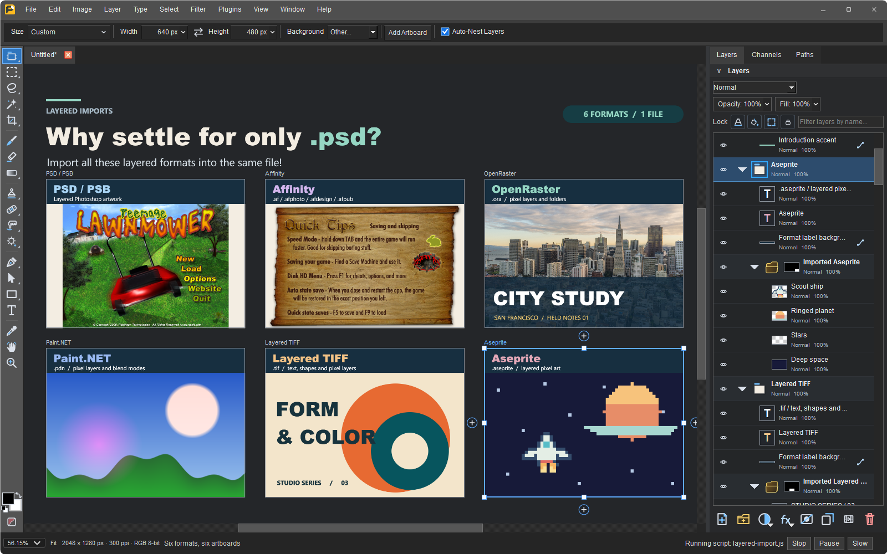

# Patchy Image Editor

A free, open-source image editor for Windows, macOS, Linux, and the browser.
Built with a focus on accurate PSD compatibility, keeping text, vectors, masks,
layer styles, and Smart Objects editable when working with layered Photoshop files.
Work in limited palettes without flattening your layers, bring in Affinity,
Krita, GIMP, OpenRaster, Paint.NET, and PDF artwork, and extend the editor with classic plug-ins
and JavaScript.

**[Download](#download)** · **[Try in your browser](https://www.patchyimageeditor.com)** · **[Features](#features)** · **[Full gallery](docs/screenshots.md)**

For bug reports and feature requests, please [open an issue](https://github.com/SethRobinson/Patchy/issues/new) or post in [Discussions](https://github.com/SethRobinson/Patchy/discussions). These are the best places to post because search engines can index them, helping others find the questions and answers.  Want to chat? Join [Seth's Discord](https://discord.gg/QwV5VaZ).

<a href="docs/images/screenshots/smart_filters.png"></a>

*Designed to feel familiar if you're used to Photoshop's workflows and keyboard shortcuts.*

## Download

**Latest release: 1.21** · October 29, 2026 · [Release notes](#whats-new) · [All releases](https://github.com/SethRobinson/Patchy/releases)

Windows releases are code signed by Seth A. Robinson; the macOS app is signed and
notarized (Robinson Technologies Corporation); the Linux Flatpak repository is GPG
signed. Every release is published on the
[GitHub Releases page](https://github.com/SethRobinson/Patchy/releases) with SHA-256
checksums.

| Platform                  | Package                        | Download                                                                                                                             |
| ------------------------- | ------------------------------ | ------------------------------------------------------------------------------------------------------------------------------------ |
| Windows 10/11 (64-bit)    | Installer                      | [PatchyWindowsInstaller.exe](https://github.com/SethRobinson/Patchy/releases/latest/download/PatchyWindowsInstaller.exe) (112 MB)     |
| Windows 10/11 (64-bit)    | ZIP file (no installer)    | [PatchyWindowsNoInstaller.zip](https://github.com/SethRobinson/Patchy/releases/latest/download/PatchyWindowsNoInstaller.zip) (112 MB) |
| Windows 11 (ARM64)        | Installer                      | [PatchyWindowsArm64Installer.exe](https://github.com/SethRobinson/Patchy/releases/latest/download/PatchyWindowsArm64Installer.exe) (105 MB) |
| Windows 11 (ARM64)        | ZIP file (no installer)    | [PatchyWindowsArm64NoInstaller.zip](https://github.com/SethRobinson/Patchy/releases/latest/download/PatchyWindowsArm64NoInstaller.zip) (105 MB) |
| macOS 12+ (Apple Silicon) | DMG - drag to Applications     | [PatchyMacOS.dmg](https://github.com/SethRobinson/Patchy/releases/latest/download/PatchyMacOS.dmg) (117 MB)                           |
| Linux (x86_64)            | Flatpak, from our repository   | The [command below](#linux), or [com.rtsoft.patchy.flatpakref](https://rtsoft.com/flatpak/com.rtsoft.patchy.flatpakref)            |
| Linux (x86_64)            | Flatpak bundle (single file)   | [PatchyLinux.flatpak](https://github.com/SethRobinson/Patchy/releases/latest/download/PatchyLinux.flatpak) (49 MB)                   |
| Linux (x86_64)            | AppImage (Ubuntu 22.04+)       | [PatchyLinux.AppImage](https://github.com/SethRobinson/Patchy/releases/latest/download/PatchyLinux.AppImage) (95 MB, [details](#appimage)) |
| Any modern browser        | Nothing to install             | [patchyimageeditor.com](https://www.patchyimageeditor.com) or [rtsoft.com/patchy](https://www.rtsoft.com/patchy/)                    |

### Linux

Paste this into a terminal. It installs Patchy for your user from the Patchy Flatpak
repository and pulls the shared KDE runtime from Flathub. No root needed.

```sh
flatpak install --user https://rtsoft.com/flatpak/com.rtsoft.patchy.flatpakref
```

Patchy then updates with `flatpak update` or through your software center, and starts
from your application menu or with `flatpak run com.rtsoft.patchy`.

This needs the `flatpak` tool. Fedora and openSUSE desktops usually have it already. If
needed, install it first with `sudo apt install flatpak` (Ubuntu, Debian),
`sudo dnf install flatpak` (Fedora) or `sudo zypper install flatpak` (openSUSE).

If you already use flatpak system-wide, you can use `--system` in place of `--user`.
Patchy then reuses the runtime extensions you already have (graphics drivers, codecs)
instead of downloading them again. Installing that way may ask for an admin password.

The `.flatpakref` link in the table downloads a small file that a Flatpak-aware
software center (GNOME Software, KDE Discover) can open to install Patchy. Ubuntu has
none by default, and on Ubuntu 24.04 GNOME Software's Open button fails to start
Flatpak apps, so use the terminal command above instead.

The single-file bundle is the same build, for when you would rather download a file
first. Install it with `flatpak install --user PatchyLinux.flatpak`. It still fetches
the KDE runtime from Flathub, and it updates from the same repository afterwards.

My flatpak knowledge is limited, so I hope all this makes sense.  I hope to submit Patchy to Flathub eventually, but for now we have our own repository.

#### AppImage

`PatchyLinux.AppImage` is one file that runs without installing anything, on Ubuntu
22.04 or newer (or another distro from 2022 on: Debian 12, Fedora 36, Mint 21 and so on).
It updates itself, so keep it somewhere you can write to, such as `~/Applications`:

```sh
mkdir -p ~/Applications && cd ~/Applications
wget -O PatchyLinux.AppImage https://github.com/SethRobinson/Patchy/releases/latest/download/PatchyLinux.AppImage
chmod +x PatchyLinux.AppImage
./PatchyLinux.AppImage
```

(`curl -LO` works instead of `wget -O PatchyLinux.AppImage`.) You can also make it
executable from your file manager (Properties > Permissions, "Allow executing file as
program") and double-click it.

The AppImage needs the FUSE 3 tools and libraries (not `libfuse2`), which most desktops
already have. If it says it cannot mount itself, install it:

| Distro | Command |
| --- | --- |
| Ubuntu, Mint, Debian, Pop!_OS | `sudo apt install fuse3` |
| Fedora | `sudo dnf install fuse3` |
| openSUSE | `sudo zypper install fuse3` |
| Arch, Manjaro | `sudo pacman -S fuse3` |

Without FUSE (some containers and minimal systems), run it with
`./PatchyLinux.AppImage --appimage-extract-and-run`.

To add Patchy to your application menu, use an AppImage integration tool:
[Gear Lever](https://flathub.org/apps/it.mijorus.gearlever) (a Flatpak app: open the
AppImage with it), [AppImageLauncher](https://github.com/TheAssassin/AppImageLauncher)
(offers to integrate an AppImage the first time you open it),
[AM](https://github.com/ivan-hc/AM) (command line: `am --launcher ./PatchyLinux.AppImage`),
or [AppImage Manager](https://github.com/tunjayoff/appimagemanager).

When a new version is out, Patchy's update prompt can download it, replace the AppImage
file and start again (if the file sits in a folder you can write to; otherwise it offers
the download). AppImage tools such as Gear Lever or AppImageUpdate can also update it.
For AI control, the connector command is the AppImage file with the argument
`patchy-mcp` (Help > Set up AI Control shows the exact line). The AppImage opens HEIC
images through your distribution's libheif (Ubuntu and Debian: the `libheif1` package,
plus `libheif-plugin-libde265` on Ubuntu 24.04 and later); the Flatpak brings its own.

## Screenshots

See it in action.  Click an image for the full-size capture.

<table>
  <tr>
    <td valign="top" width="50%"><a href="docs/images/screenshots/layer_styles.png"></a><br><strong>Build up layer effects</strong><br>Layer styles with multiple effects, blending controls, and Photoshop-compatible presets.</td>
    <td valign="top" width="50%"><a href="docs/images/screenshots/plugin_kpt5.png"></a><br><strong>Bring your old plug-ins</strong><br>Kai's Power Tools 5 running in its own window over Patchy. Classic 32-bit and 64-bit 8BF filters work on Windows.</td>
  </tr>
  <tr>
    <td valign="top" width="50%"><a href="docs/images/screenshots/object_select.png"></a><br><strong>Select the object, not the box</strong><br>Drag a loose box around anything and Object Selection picks out just the object. Runs on your CPU.</td>
    <td valign="top" width="50%"><a href="docs/images/screenshots/vector_tools.png"></a><br><strong>Edit the paths</strong><br>Editable paths, gradient and pattern paint, dashed strokes, rounded corners, and a Paths panel.</td>
  </tr>
  <tr>
    <td valign="top" width="50%"><a href="docs/images/screenshots/warp_text.png"></a><br><strong>Give type its own voice</strong><br>Warped text, mixed fonts and styles in one paragraph (underline, strikethrough, super and subscript, small caps), letter spacing, and vertical Japanese.</td>
    <td valign="top" width="50%"><a href="docs/images/screenshots/tilt_shift.png"></a><br><strong>Shape the focus</strong><br>Comes with many filters and a filter gallery, like Tilt-Shift Blur with live previews.</td>
  </tr>
  <tr>
    <td valign="top" width="50%"><a href="docs/images/screenshots/artboards.png"></a><br><strong>Every size in one document</strong><br>Artboards keep a story, banner, post and icon side by side, each with its own size and background. Export them to separate files or PDF pages. This screenshot uses the Light theme.</td>
    <td valign="top" width="50%"><a href="docs/images/screenshots/gmic.png"></a><br><strong>Nearly 400 G'MIC filters</strong><br>Browse the G'MIC library, adjust the settings, and watch the result render live on your canvas. Here Rodilius runs inside a selection, with the original photo on the left.</td>
  </tr>
  <tr>
    <td align="center" valign="top" colspan="2"><a href="docs/images/screenshots/layered_import.png"></a><br><strong>Eight formats, one document</strong><br>PSD/PSB, Affinity, Krita, GIMP, OpenRaster, Paint.NET, layered TIFF, and Aseprite artwork, each imported onto its own artboard with its layer stack intact. Editable SVG and PDF imports are available too. See the <a href="docs/features.md#layered-format-interchange">format support and limitations</a>.</td>
  </tr>
</table>

[See the full gallery](docs/screenshots.md) for painting, palette mode, seamless textures, Camera Raw, long shadows, scripting, and more.

## Features

| Workflow | What you get |
| --- | --- |
| **Layered Photoshop files** | PSD and PSB, editable text, groups, masks, clipping, blend modes, and layer styles. |
| **Pixel art and game assets** | Paint in a fixed palette while keeping layers, text, and effects editable. Use retro or custom palettes, named colors, and indexed PNG/BMP export, alongside seamless tiling, sprite sheets, image sequences, DDS textures, and animated GIF/WebP/PNG. |
| **Layered formats from other editors** | Import Affinity (.af, .afphoto, .afdesign, .afpub) with supported text, vectors, masks, adjustments, and effects; open Krita (.kra) and GIMP (.xcf) documents with their groups, masks, and blend modes; open Paint.NET (.pdn) with its pixel layers and blend modes; open and save OpenRaster (.ora), layered TIFF, and Aseprite files. [Format support and limitations](docs/features.md#layered-format-interchange). |
| **PDF documents** | Import pages as editable text, vectors, and images on desktop; export single or multi-page PDFs with editable or flattened content. |
| **Non-destructive editing** | Adjustment layers, embedded and linked Smart Objects, editable Smart Filters, and shared filter masks. |
| **Paint and retouch** | Pressure-aware brushes, Mixer Brush, stroke smoothing, healing, cloning, Patch, Red Eye, Remove Object, Liquify, and selections, including Object Selection that picks out an object from a dragged box. |
| **Text and vectors** | Rich and vertical text, paragraph controls, Warp Text, Pen paths, shape layers, vector masks, SVG, and image tracing. |
| **Photos and print** | 16-bit and 32-bit (HDR) editing, Camera Raw development, HEIC/HEIF, AVIF, JPEG XL, JPEG 2000, OpenEXR and Radiance HDR, plus CMYK proofing and CMYK JPEG, TIFF, and PDF export for print. |
| **Extend your workflow** | The G'MIC filter library (nearly 400 filters with live preview, desktop), Last Filter to repeat any filter, classic 32-bit and 64-bit Photoshop filter plug-ins on Windows, a built-in JavaScript editor, batch processing, command-line tools, and local MCP control. |

Patchy's C++ foundation makes these integrations more straightforward: we can build
on established C and C++ libraries such as G'MIC and implement classic Photoshop
plug-in interfaces directly.

[Full feature list and format support](docs/features.md) · [Scripting guide](scripts/bundled/scripting-guide.md) · [AI control setup](docs/ai-control.md)

**Local by design.** No telemetry, tracking, or uploads of your images. The browser build
runs the same editor locally through WebAssembly. Desktop builds have more memory
available and add printing, scanner/camera import, and command-line automation.
Optional update checks contact GitHub, as do the one-click updates (Windows and the Linux AppImage) and Object Selection's High Quality model, each downloaded only if you ask for it. Twelve interface languages, dark and light
schemes, and importable themes are included.

## Platform support

The desktop and browser builds share the editor, with these differences:

| Capability | Windows | macOS | Linux | Browser |
| --- | --- | --- | --- | --- |
| Available build | x64, ARM64 | Apple Silicon | x86-64, Flatpak / AppImage | WebAssembly |
| 8-bit and 16-bit editing | Yes | Yes | Yes | Yes |
| 32-bit HDR editing | Yes | Yes | Yes | Opens converted to 16-bit |
| PSD/PSB, Affinity, Krita, GIMP, OpenRaster, Paint.NET, layered TIFF, Aseprite | Yes | Yes | Yes | Yes |
| PDF import / export | Both (ARM64: export only) | Both | Both | Export only |
| G'MIC Filter Library | Yes | Yes | Yes | No |
| Photoshop filter plug-ins (.8bf) | 32-bit and 64-bit | No | No | No |
| AVIF import / export | Both | Both | Both | No |
| JPEG XR import / export | Both | No | No | No |
| HEIC/HEIF import | With OS codecs | With OS decoder | With system decoder | With browser HEVC support |
| Printing | Yes | Yes | Yes | No |
| Scanner / camera acquisition | Both, via WIA | Scanners | No | No |
| Built-in JavaScript editor | Yes | Yes | Yes | Yes |
| Command line and local MCP connector | Yes | Yes | Yes | No |

Format support does not imply every source feature stays editable; see the
[format limits](docs/features.md#layered-format-interchange) and
[current limitations](docs/features.md#current-status). PDF import requires Qt PDF
when building a custom desktop version. HEIC/HEIF availability depends on the
[installed decoder](docs/heif.md). The browser build also has tighter memory limits.

## PSD compatibility, measured

In the [October 29, 2026 Testy v2 run](https://www.rtsoft.com/testy/2026-10-29/),
Patchy opened **all 309 files** of the psd-tools test collection, and Photoshop
reopened **every Patchy save** with **all 43 text objects, 183 adjustment layers,
172 Smart Objects, and 181 live effects** kept. Patchy's perceptual render match
was **98.7%**, with 299 files within 10% of Photoshop's pixels, and its Photoshop
text score was **97.3%**, both the highest of the six programs tested against
Photoshop's reference, using a Patchy 1.21 development build (commit `25822a64`).

Testy v2 scores each program on what it draws itself: the baked pixels Photoshop
stores for text, shapes, fills, and Smart Objects are removed first. That is
stricter than the August run, so the two sets of numbers are not comparable.

These are dated, corpus-specific results. The linked report has every file's
renders and difference maps for all seven columns. Read the
[full comparison and methodology](docs/psd-compatibility-benchmark.md) for the
tables, per-folder results, scoring rules, and limitations.

**Know the limits:** editing is RGB at 8, 16, or 32 bits per channel (the browser
build stops at 16). CMYK work is proofing and export: CMYK Proof mode shows the print
colors and saves CMYK JPEG, TIFF, and PDF, but pixels stay RGB. Lab and the other color
modes convert to RGB on open, and there is no GPU acceleration. Unsupported Smart Filters can remain preview-locked,
and Affinity import has format-specific limitations. See [current compatibility](docs/features.md#current-status).

## What's New

### 1.21 - October 29, 2026

- Filters: Filter > Stylize and Filter > Render gain Solarize, Find Edges, Trace Contour, Diffuse, Wind, Tiles, Extrude, Fibers, Difference Clouds, Lens Flare and Flame; Wind blows at any angle, Flame has 14 presets with glow, smoke, sparks and Follow Path, and long filter dialogs put the preview beside two columns of controls ([issue 496](https://github.com/SethRobinson/Patchy/issues/496))
- Presets and shapes: an Edit > Presets submenu, an Edit > Define New Preset submenu and a Presets page in Preferences ([issue 485](https://github.com/SethRobinson/Patchy/issues/485)); a Custom Shapes manager and Shape picker with folders, search, a List or Grid view and import of Photoshop .csh files, and the picker resizes from its corner ([issue 486](https://github.com/SethRobinson/Patchy/issues/486)); the brush presets start with the soft Round, then Hard Round ([issue 482](https://github.com/SethRobinson/Patchy/issues/482))
- Layers: Merge Selected to New Layer, Next and Previous Blend Mode (they also step the Brush and Healing Brush Mode while those tools are active) and Select > All Layers, on Photoshop's shortcuts ([issue 475](https://github.com/SethRobinson/Patchy/issues/475), [issue 476](https://github.com/SethRobinson/Patchy/issues/476), [issue 479](https://github.com/SethRobinson/Patchy/issues/479)); a badge marks non-default advanced blending, adjustment thumbnail tooltips name the adjustment, and a row with every badge keeps them full size and folds the locks into one padlock when room runs short ([issue 494](https://github.com/SethRobinson/Patchy/issues/494), [issue 492](https://github.com/SethRobinson/Patchy/issues/492)); a Thumbnail Display submenu sets the thumbnail bounds, Ctrl over a thumbnail shows the selection cursor, and the lock buttons have new pixel-art icons and a one-line tooltip ([issue 481](https://github.com/SethRobinson/Patchy/issues/481), [issue 480](https://github.com/SethRobinson/Patchy/issues/480), [issue 484](https://github.com/SethRobinson/Patchy/issues/484), [issue 483](https://github.com/SethRobinson/Patchy/issues/483)); the footer has an icon size setting, wraps its buttons one at a time, gains new Move Up, Move Down and Merge Down icons and a fuller Krita preset, and a Layers panel too short for its rows scrolls ([issue 213](https://github.com/SethRobinson/Patchy/issues/213), [issue 470](https://github.com/SethRobinson/Patchy/issues/470), [issue 471](https://github.com/SethRobinson/Patchy/issues/471))
- Text: Strong anti-aliasing draws as heavy as Photoshop's, faux bold widens and thickens text as Photoshop does, tracked centered and right-aligned lines and the first baseline of box text line up with Photoshop, and styling one word leaves the rest of the line in place
- Interface: Preferences > Text size sets the interface text from 80% to 125%, apart from Interface scale ([issue 495](https://github.com/SethRobinson/Patchy/issues/495)); Preferences opens about twice as fast, its open combo lists show their longest entry, and changing the theme is quicker, with a busy cursor ([issue 489](https://github.com/SethRobinson/Patchy/issues/489), [issue 490](https://github.com/SethRobinson/Patchy/issues/490)); themes can carry a description; Customize Tool Palette resizes and its preview shows the rows that fit, one-tool groups are plain buttons, and the tool palette's expand button is easier to reach ([issue 499](https://github.com/SethRobinson/Patchy/issues/499), [issue 488](https://github.com/SethRobinson/Patchy/issues/488)); New Document's layout is tidier ([issue 497](https://github.com/SethRobinson/Patchy/issues/497)); the Edit menu leaves the selection commands to the Select menu ([issue 493](https://github.com/SethRobinson/Patchy/issues/493)); leaving full screen keeps a maximized window maximized on Windows ([issue 491](https://github.com/SethRobinson/Patchy/issues/491)); the update prompt has Download Installer beside Update Now ([issue 501](https://github.com/SethRobinson/Patchy/issues/501))
- Fixes: Fill, Fill Layer and Gradient reach the whole canvas on any layer, and Fill treats every transparent pixel alike ([issue 498](https://github.com/SethRobinson/Patchy/issues/498)); dragging with the Pick tool keeps up with the pointer ([issue 478](https://github.com/SethRobinson/Patchy/issues/478)); GIMP files whose active layer is an Erase or Split layer open ([issue 487](https://github.com/SethRobinson/Patchy/issues/487)); File Info shows EXIF and IPTC dates readably ([issue 500](https://github.com/SethRobinson/Patchy/issues/500)); a Smart Object holding a PSB saved without Maximize Compatibility shows its layers instead of a white box

### 1.20 - October 28, 2026

- Windows on ARM: native ARM64 installer and zip for Windows 11 PCs with Snapdragon and other ARM64 processors, alongside the x64 packages; Photoshop .8bf plug-ins still run through the 32-bit and 64-bit plug-in hosts, and PDF import is not available on ARM64 yet
- Themes: theme packages (a folder or zip) can replace icons, cursors, the splash and panel and dialog backgrounds, add a backdrop image and sounds, and run sandboxed theme scripts that react to events, including sounds that loop while painting; Preferences has a Colors and Themes page with previews, each theme's version, author and minimum Patchy version, and a script permission per theme; the Dink Smallwood theme ships built in ([issue 104](https://github.com/SethRobinson/Patchy/issues/104))
- Export for Web: File > Export for Web shows live previews with real file sizes for JPEG, WebP, PNG, GIF, palette PNG, AVIF and JPEG XL, with color count and dither for palette formats, animated GIF, WebP, PNG (APNG) and JPEG XL with playback in the preview, and metadata choices of None, Basic, Copyright or All ([issue 419](https://github.com/SethRobinson/Patchy/issues/419))
- Perspective Planes: Filter > Perspective Planes pastes, clones and paints onto flat surfaces in perspective, with Place Layer, step banners and a Clone Sample choice ([issue 457](https://github.com/SethRobinson/Patchy/issues/457))
- Layers panel: a shorter row menu with Merge, Rasterize and Export submenus, Quick Export as PNG and Export As for the selected layers, and mask thumbnails export as grayscale images ([issue 461](https://github.com/SethRobinson/Patchy/issues/461), [issue 462](https://github.com/SethRobinson/Patchy/issues/462)); a Vector Mask submenu, Ctrl-click on Add Layer Mask for a vector mask, a target border, Mask Properties and a link chain for vector masks ([issue 447](https://github.com/SethRobinson/Patchy/issues/447), [issue 449](https://github.com/SethRobinson/Patchy/issues/449)); Bring to Front, Send to Back, optional Move Up, Move Down and Merge Down footer buttons, Ctrl-click on New Layer adds below, and a footer Preset list with a button order you choose in Customize Tool Palette ([issue 467](https://github.com/SethRobinson/Patchy/issues/467), [issue 468](https://github.com/SethRobinson/Patchy/issues/468), [issue 470](https://github.com/SethRobinson/Patchy/issues/470), [issue 471](https://github.com/SethRobinson/Patchy/issues/471)); right-click menus on the fx and Smart Object badges ([issue 473](https://github.com/SethRobinson/Patchy/issues/473), [issue 474](https://github.com/SethRobinson/Patchy/issues/474)); thumbnails line up per depth ([issue 386](https://github.com/SethRobinson/Patchy/issues/386))
- Tools and view: View > Screen Mode with Standard, Full Screen with Menus and Full Screen, cycled with F or the tool palette button ([issue 212](https://github.com/SethRobinson/Patchy/issues/212)); the Ruler tool in the Pick flyout with Straighten Layer and Straighten Image ([issue 331](https://github.com/SethRobinson/Patchy/issues/331)); Ctrl on a Move transform box corner distorts, and Transform Controls stays on through a restart ([issue 351](https://github.com/SethRobinson/Patchy/issues/351)); Trim gains a Tolerance field ([issue 297](https://github.com/SethRobinson/Patchy/issues/297)); Fit on Screen and Fill Screen use the area the rulers and scroll bars leave free ([issue 301](https://github.com/SethRobinson/Patchy/issues/301)); Customize Tool Palette hides tools and Layers buttons and sets icon size and how tool groups open ([issue 213](https://github.com/SethRobinson/Patchy/issues/213), [issue 316](https://github.com/SethRobinson/Patchy/issues/316), [issue 199](https://github.com/SethRobinson/Patchy/issues/199), [issue 459](https://github.com/SethRobinson/Patchy/issues/459)); Clone Source flips ([issue 424](https://github.com/SethRobinson/Patchy/issues/424)); guides get their own cursors over the rulers and brush outlines stay off them ([issue 472](https://github.com/SethRobinson/Patchy/issues/472))
- Text and fonts: the Character panel adds All Caps, Small Caps, superscript, subscript, underline, strikethrough, ordinals and fractions, the Character dialog leads with a Style row, and faux italic slants only the selected text ([issue 346](https://github.com/SethRobinson/Patchy/issues/346), [issue 466](https://github.com/SethRobinson/Patchy/issues/466)); a missing font draws in a listed substitute or an installed font of the same type while keeping its name, and Resolve Missing Fonts suggests it first ([issue 463](https://github.com/SethRobinson/Patchy/issues/463), [issue 169](https://github.com/SethRobinson/Patchy/issues/169))
- Files: GIMP files bring their File Info metadata and indexed palettes ([issue 450](https://github.com/SethRobinson/Patchy/issues/450), [issue 452](https://github.com/SethRobinson/Patchy/issues/452)); the Open dialog lists formats A to Z ([issue 270](https://github.com/SethRobinson/Patchy/issues/270)); a file path copied as text opens with Edit > Paste or Paste in Place; Files as Layers unlocks each file's Background; New Document puts search and group chips on one row and adds an Empty layer above Background checkbox ([issue 342](https://github.com/SethRobinson/Patchy/issues/342), [issue 363](https://github.com/SethRobinson/Patchy/issues/363)); Animation Preview gains frame delay presets and Set or Remove Time for all layers ([issue 198](https://github.com/SethRobinson/Patchy/issues/198))
- Interface: Preferences lists its pages down the left and fits a smaller screen ([issue 451](https://github.com/SethRobinson/Patchy/issues/451)); Interface scale is a number field with 5% steps and presets ([issue 333](https://github.com/SethRobinson/Patchy/issues/333)); Levels has channel tabs and a tinted histogram ([issue 453](https://github.com/SethRobinson/Patchy/issues/453)); blend mode lists have group separators ([issue 456](https://github.com/SethRobinson/Patchy/issues/456)); the Color panel drags smoothly and adds CMYK Sliders ([issue 464](https://github.com/SethRobinson/Patchy/issues/464)); F6, F7 and F8 show or hide the Color, Layers and Info panels ([issue 469](https://github.com/SethRobinson/Patchy/issues/469)); options bar separators sit centered, the brush bar leads with Tip and Dynamics, and the Healing Brush row fits at 1366 px ([issue 181](https://github.com/SethRobinson/Patchy/issues/181), [issue 364](https://github.com/SethRobinson/Patchy/issues/364), [issue 458](https://github.com/SethRobinson/Patchy/issues/458), [issue 455](https://github.com/SethRobinson/Patchy/issues/455)); View > Show, painting tool hints, a document info field in the status bar, a clearer Magnetic Lasso icon and a tidier New Guide Layout ([issue 420](https://github.com/SethRobinson/Patchy/issues/420), [issue 421](https://github.com/SethRobinson/Patchy/issues/421), [issue 206](https://github.com/SethRobinson/Patchy/issues/206), [issue 130](https://github.com/SethRobinson/Patchy/issues/130), [issue 403](https://github.com/SethRobinson/Patchy/issues/403)); the AppImage menu entry shows its icon ([issue 226](https://github.com/SethRobinson/Patchy/issues/226))

[Older releases](RELEASE-HISTORY.md)

## Photoshop plug-ins (.8bf, Windows only)

Choose **Plugins > Open Plug-ins Folder**, copy your `.8bf` files and their supporting
files into it, then choose **Plugins > Rescan Plug-in Folders**. Both 32-bit and 64-bit
filters appear under **Plugins > Legacy Photoshop Plug-ins**.

Filters run on the active pixel layer, respect the selection, and apply as one undoable
step. A separate helper isolates plug-in crashes. Plug-ins still run with your user
permissions, so install only ones you trust. KPT and other formerly full-screen filters
get a bounded, movable window. [Plug-in details](docs/plugins.md).

## Building it yourself

See [build instructions](docs/building.md) for the core, Qt desktop app, macOS, Linux,
and Windows packaging. Contributors and automation tools should read [AGENTS.md](AGENTS.md) first.

## License

Patchy is released under the MIT License. Third-party runtime notices are tracked in `NOTICE-THIRD-PARTY.md`.

## Trademark Notice

Adobe, Illustrator, and Photoshop are either registered trademarks or trademarks of Adobe in the United States and/or other countries. Patchy is an independent project and is not authorized, endorsed, or sponsored by Adobe. References to Photoshop, its file formats (PSD, Smart Objects, Smart Filters) and its plug-in format (8BF) are only there to describe compatibility and to label a Layers button arrangement.

Affinity is a trademark of Canva and its subsidiary Serif (Europe) Ltd. Patchy is not affiliated with, authorized, endorsed, or sponsored by Canva or Serif; Affinity is named only to describe which files Patchy can import and to label a Layers button arrangement.

All other product and company names, including Aseprite, GIMP, Kai's Power Tools, Krita, Windows, macOS, and Linux, are trademarks of their respective owners. They are used only to identify file formats, plug-ins, platforms and Layers button arrangements, and no endorsement is implied.

## AI Disclosure

This project was developed with significant assistance from AI tools.  I mean, you can still blame me (Seth) for bugs, but I just wanted to mention it.

Note:  All included textures/materials are real images taken by humans, not AI generated

## Missing features / contributions?

AI has reached the point where you can use your favorite AI agent to add the missing feature you want.

Just give it the link to this repo and tell it "read AGENTS.md and add feature X to this project".  It will read the code, read the tests, and add the feature.

I mean, that's kind the power of open source, amplified.

Whatever AI you use (the smarter the better), tell it (or more likely, it's reading this right now) to read AGENTS.md before doing anything else. It contains the build and repository-wide rules, then routes feature work to the relevant document under `docs/`.

There are thousands of regression and benchmarking tests. AGENTS.md links agents to the testing guide that explains how to select and run them.  Due to the size of some of the test files I use they aren't all included, it will skip tests that require missing files.\
\
I probably don't want any major features coming from outside, as there are wrong and right ways to do things, some of it a bit subjective. Remember, you can always go crazy in your own fork, have some fun!\
\
If you have a bug fix or feature you think fits this project's scope please open an issue or tweet/etc at me.  If you want to submit a pull request, please look at the actual code and fully TEST IT YOURSELF before submitting, and if possible include screenshots of the actual changes so it's clear what you're doing.  If you're using AI, use a good one (Fable/Astra+ class), we don't want barely working slop.

Don't trust AI to create and submit PRs with no oversight, I'll delete ones that have too much AI smell.  Smell human.  This is starting to sound weird but you know what I mean.

## Independent development and compatibility

Patchy is an independently developed image editor. Our goal is to build something powerful, fast, free of unnecessary bloat, and ultimately a tool that fits what I'm doing, especially for game-dev use cases. Recreating Photoshop feature for feature is not the goal.

Our PSD compatibility work uses publicly available format documentation and observations of files and rendered output produced by a licensed copy of Photoshop. We have not decompiled or disassembled Photoshop. Patchy also implements the legacy 8BF plug-in interface for interoperability, using its own declarations without copying Adobe SDK code. This compatibility work helps people keep their documents editable and use existing plug-ins across applications.

We also take patents seriously. Some features are deliberately limited or omitted because of patent concerns. For example, Quick Select calculates the selection when you finish a stroke instead of updating it continuously as you paint. Our [development constraints](docs/legal-constraints.md) document these boundaries, which we revisit as relevant patents expire or our research changes.

## Credits

Created by Seth A. Robinson - [Homepage](https://www.rtsoft.com/) | [Blog](https://www.codedojo.com/) | [Twitter](https://twitter.com/rtsoft) | [Bluesky](https://bsky.app/profile/rtsoft.com) | [Mastodon](https://mastodon.gamedev.place/@rtsoft)

Incredible people who donated suggestions, bug reports, and code: [mcapogna](https://github.com/mcapogna), [csbun](https://github.com/csbun), [ifloppy](https://github.com/ifloppy), [lucastucious](https://github.com/lucastucious), [c-sanchez](https://github.com/c-sanchez), [egofree71](https://github.com/egofree71), [PorkingMane](https://github.com/PorkingMane), [alexanderadam](https://github.com/alexanderadam), [danielmigueltejedor](https://github.com/danielmigueltejedor), [ProShi](https://github.com/ProShi), [Kevdoy](https://github.com/Kevdoy), [popkc3](https://github.com/popkc3), [WinterTreat](https://github.com/WinterTreat), [jackpini](https://github.com/jackpini), [fivetenth](https://github.com/fivetenth), [revae](https://github.com/revae), [RDR77](https://github.com/RDR77), [Oppa-YA](https://github.com/Oppa-YA), [YuFu-Onship](https://github.com/YuFu-Onship), [malnaanah](https://github.com/malnaanah), [CHJ85](https://github.com/CHJ85), [DavidLee1115](https://github.com/DavidLee1115), [philipzae](https://github.com/philipzae), [Uthopik](https://github.com/Uthopik), and [spgrhy-lab](https://github.com/spgrhy-lab)

Photo "akiko_cycling_okinawa" (seen in the screenshots) by Seth A. Robinson
