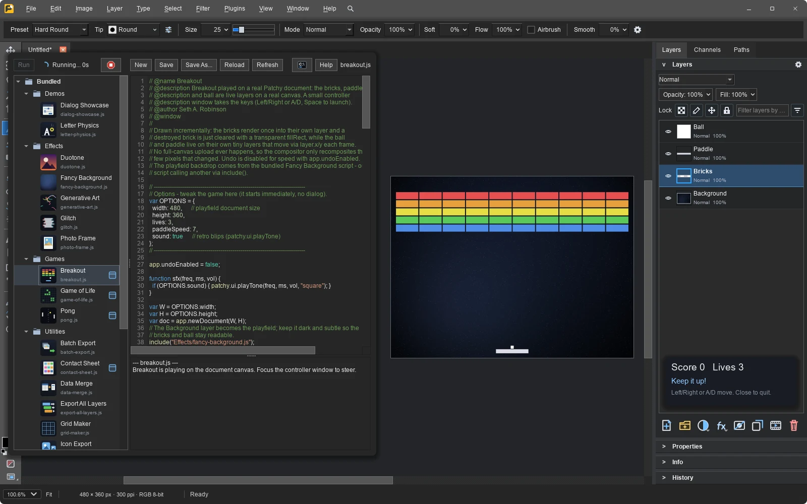
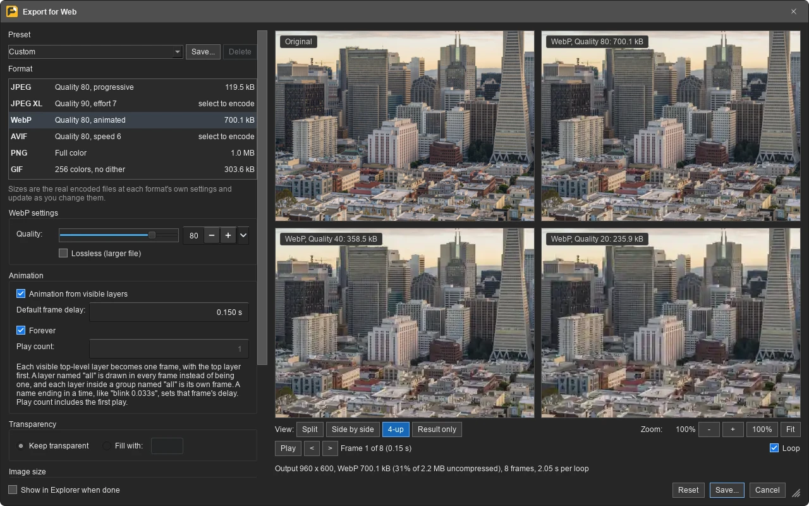
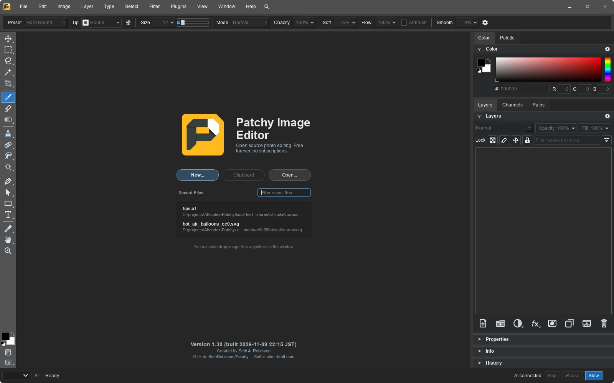

# Patchy Image Editor

A free, open-source image editor for Windows, macOS, Linux, and the browser, made with
game art and pixel art in mind. It focuses on accurate PSD compatibility, keeping text,
vectors, masks, layer styles, and Smart Objects editable in layered Photoshop files, and
its workflows and keyboard shortcuts will feel familiar if you know Photoshop. Paint in
limited palettes without flattening your layers, bring in Affinity, Krita, GIMP,
OpenRaster, Paint.NET, and PDF artwork, and extend the editor with classic plug-ins and
JavaScript.

**[Download](#download)** · **[Try in your browser](https://www.patchyimageeditor.com)** · **[Watch the video](https://www.youtube.com/watch?v=xhM6RvmcjGU)** · **[Features](#features)** · **[Full gallery](docs/screenshots.md)**

For bug reports and feature requests, please [open an issue](https://github.com/SethRobinson/Patchy/issues/new) or post in [Discussions](https://github.com/SethRobinson/Patchy/discussions). These are the best places to post because search engines can index them, helping others find the questions and answers. Want to chat? Join [Seth's Discord](https://discord.gg/QwV5VaZ).

<a href="docs/images/screenshots/smart_filters.png"></a>

## Download

**Latest release: 1.35** · November 14, 2026 · [Release notes](#whats-new) · [All releases](https://github.com/SethRobinson/Patchy/releases)

Windows releases are code signed by Seth A. Robinson; the macOS app is signed and
notarized (Robinson Technologies Corporation); the Linux Flatpak repository is GPG
signed. Every release is published on the
[GitHub Releases page](https://github.com/SethRobinson/Patchy/releases) with SHA-256
checksums.

| Platform                  | Package                        | Download                                                                                                                             |
| ------------------------- | ------------------------------ | ------------------------------------------------------------------------------------------------------------------------------------ |
| Windows 10/11 (64-bit)    | Installer                      | [PatchyWindowsInstaller.exe](https://github.com/SethRobinson/Patchy/releases/latest/download/PatchyWindowsInstaller.exe) (134 MB)     |
| Windows 10/11 (64-bit)    | ZIP file (no installer)    | [PatchyWindowsNoInstaller.zip](https://github.com/SethRobinson/Patchy/releases/latest/download/PatchyWindowsNoInstaller.zip) (134 MB) |
| Windows 11 (ARM64)        | Installer                      | [PatchyWindowsArm64Installer.exe](https://github.com/SethRobinson/Patchy/releases/latest/download/PatchyWindowsArm64Installer.exe) (124 MB) |
| Windows 11 (ARM64)        | ZIP file (no installer)    | [PatchyWindowsArm64NoInstaller.zip](https://github.com/SethRobinson/Patchy/releases/latest/download/PatchyWindowsArm64NoInstaller.zip) (124 MB) |
| macOS 12+ (Apple Silicon) | DMG - drag to Applications     | [PatchyMacOS.dmg](https://github.com/SethRobinson/Patchy/releases/latest/download/PatchyMacOS.dmg) (134 MB)                           |
| Linux (x86_64)            | Flatpak, from our repository   | The [command below](#linux), or [com.rtsoft.patchy.flatpakref](https://rtsoft.com/flatpak/com.rtsoft.patchy.flatpakref)            |
| Linux (x86_64)            | Flatpak bundle (single file)   | [PatchyLinux.flatpak](https://github.com/SethRobinson/Patchy/releases/latest/download/PatchyLinux.flatpak) (63 MB)                   |
| Linux (x86_64)            | AppImage (Ubuntu 22.04+)       | [PatchyLinux.AppImage](https://github.com/SethRobinson/Patchy/releases/latest/download/PatchyLinux.AppImage) (110 MB, [details](docs/install-linux.md#appimage)) |
| Linux (ARM64)             | Flatpak, from our repository   | The same [command below](#linux) ([Raspberry Pi 5 and other ARM computers](docs/install-linux.md#linux-on-arm64-raspberry-pi-5-and-others)) |
| Linux (ARM64)             | Flatpak bundle (single file)   | [PatchyLinuxArm64.flatpak](https://github.com/SethRobinson/Patchy/releases/latest/download/PatchyLinuxArm64.flatpak) (57 MB)         |
| Any modern browser        | Nothing to install             | [patchyimageeditor.com](https://www.patchyimageeditor.com) or [rtsoft.com/patchy](https://www.rtsoft.com/patchy/)                    |

### Linux

Paste this into a terminal to install the Flatpak for your user (no root needed). It
pulls the shared KDE runtime from Flathub, and the same command installs the ARM64 build
on a Raspberry Pi 5 or another 64-bit ARM computer.

```sh
flatpak install --user https://rtsoft.com/flatpak/com.rtsoft.patchy.flatpakref
```

Patchy then updates with `flatpak update` and starts from your application menu. The
[Linux install guide](docs/install-linux.md) covers getting the `flatpak` tool,
system-wide installs, the single-file bundle, Raspberry Pi setup, and the AppImage (FUSE,
menu entries, updates).

## Video

<a href="https://www.youtube.com/watch?v=xhM6RvmcjGU"></a>

A tour of Patchy in under three minutes, cut from real captures of the app: layer styles,
vectors, brushes, palette mode, PSD compatibility, filters, type, Smart Objects, scanning,
themes and scripting. [Watch it on YouTube](https://www.youtube.com/watch?v=xhM6RvmcjGU).

## Screenshots

Click an image for the full-size capture.

<table>
  <tr>
    <td valign="top" width="50%"><a href="docs/images/screenshots/layered_import.png"></a><br><strong>Eight formats with layers, one document</strong><br>PSD/PSB, Affinity, Krita, GIMP, OpenRaster, Paint.NET, layered TIFF, and Aseprite artwork, each imported onto its own artboard with its layer stack intact. Editable SVG and PDF imports are available too. See the <a href="docs/features-files.md#layered-format-interchange">format support and limitations</a>.</td>
    <td valign="top" width="50%"><a href="docs/images/screenshots/object_select.png"></a><br><strong>Select the object, not the box</strong><br>Drag a loose box around anything and Object Selection picks out just the object. Runs on your CPU.</td>
  </tr>
  <tr>
    <td valign="top" width="50%"><a href="docs/images/screenshots/breakout.webp"></a><br><strong>Scripting powerful enough to run a game</strong><br>Patchy's JavaScript API can drive a whole game: the bundled Breakout runs on a real document, with its bricks, paddle and ball as layers and its own window taking the keys. The same API works with documents, layers, text, selections, pixels, filters, dialogs and batch jobs, from the Script Manager or the command line.</td>
    <td valign="top" width="50%"><a href="docs/images/screenshots/plugin_kpt5.png"></a><br><strong>Bring your old plug-ins</strong><br>Kai's Power Tools 5 running in its own window over Patchy. Classic 32-bit and 64-bit 8BF filters work on Windows.</td>
  </tr>
  <tr>
    <td valign="top" width="50%"><a href="docs/images/screenshots/web_export_quad.webp"></a><br><strong>Export for the web</strong><br>The 4-up view plays an animated WebP at three qualities beside the original, each with its real encoded size. JPEG, JPEG XL, AVIF, PNG and GIF list their sizes too.</td>
    <td valign="top" width="50%"><a href="docs/images/screenshots/mcp_isometric.webp"></a><br><strong>Let an AI agent drive it</strong><br>Patchy's bundled MCP connector gives AI agents full control: scripts, vector shapes with gradients, Smart Objects, native brush strokes, layers, previews and undo. Here an agent builds an isometric harbor in a visible window, Slow mode pausing on every step, with Stop and Pause in the status bar. Every tree is a copy of one of two Smart Objects, so editing one updates them all.</td>
  </tr>
</table>

[See the full gallery](docs/screenshots.md) for seamless tiling with the Dink Smallwood palette, layer styles, vector tools, Warp Text and type, artboards,
scanning (Divide Scanned Photos, Scan a Book to PDF), the G'MIC and GEGL filter libraries, Tilt-Shift and other filters,
palette mode, Camera Raw, Perspective Planes, and more.

## Features

| Workflow | What you get |
| --- | --- |
| **Layered Photoshop files** | PSD and PSB, editable text, groups, masks, clipping, blend modes, and layer styles. |
| **Pixel art and game assets** | Paint in a fixed palette while keeping layers, text, and effects editable. Use retro or custom palettes, named colors, and indexed PNG/BMP export, alongside seamless tiling, sprite sheets, image sequences, DDS textures, and animated GIF/WebP/PNG. |
| **Layered formats from other editors** | Import Affinity (.af, .afphoto, .afdesign, .afpub) with supported text, vectors, masks, adjustments, and effects; open Krita (.kra) and GIMP (.xcf) documents with their groups, masks, and blend modes; open Paint.NET (.pdn) with its pixel layers and blend modes; open and save OpenRaster (.ora), layered TIFF, and Aseprite files. [Format support and limitations](docs/features-files.md#layered-format-interchange). |
| **Artboards** | Several canvases of different sizes in one document, each with its own background, saved as Photoshop artboards and exported to separate files or one PDF page each. |
| **Web and animation** | Export for Web compares JPEG, WebP, AVIF, JPEG XL, PNG and GIF by their real encoded sizes; layers become animated GIF, WebP or PNG frames with a live preview. |
| **PDF documents** | A fast PDF viewer with book and comic layouts, Print as Book for folded booklets and zines, and Scan a Book to PDF (experimental); import pages as editable text, vectors, and images on desktop; export single or multi-page PDFs with editable or flattened content. |
| **Non-destructive editing** | Adjustment layers, embedded and linked Smart Objects, editable Smart Filters, and shared filter masks. |
| **Paint and retouch** | Pressure-aware brushes, Mixer Brush, stroke smoothing, healing, cloning, Patch, Red Eye, Remove Object, Liquify, Perspective Planes, and selections, including Object Selection that picks out an object from a dragged box. |
| **Text and vectors** | Rich and vertical text, paragraph controls, Warp Text, Pen paths, shape layers, vector masks, SVG, and image tracing. |
| **Photos and print** | 16-bit and 32-bit (HDR) editing, Camera Raw development, HEIC/HEIF, AVIF, JPEG XL, JPEG 2000, OpenEXR and Radiance HDR, plus CMYK proofing and CMYK JPEG, TIFF, and PDF export for print. |
| **Extend your workflow** | The G'MIC filter library (nearly 400 filters with live preview) and over a hundred GEGL filters (desktop), Last Filter to repeat any filter, classic 32-bit and 64-bit Photoshop filter plug-ins on Windows, a built-in JavaScript editor, batch processing, command-line tools, local MCP control for AI assistants, and optional OpenAI Image Tools with your own API key. |

[Full feature list and format support](docs/features.md) · [Installing Photoshop plug-ins](docs/features.md#installing-photoshop-plug-ins-windows) · [Scripting guide](scripts/bundled/scripting-guide.md) · [AI control setup](docs/ai-control.md)

**Local by design:**

- No telemetry or tracking. Your images leave your computer only if you use the optional
  OpenAI Image Tools with your own API key.
- Optional update checks contact GitHub. One-click updates (Windows and the Linux AppImage)
  and Object Selection's High Quality model are downloaded only when you ask for them.
- The browser build runs the same editor locally through WebAssembly. Desktop builds have
  more memory available and add printing, scanner and camera import, and command-line
  automation.

Twelve interface languages, dark and light schemes, and importable themes are included.

## Platform support

The desktop and browser builds share the editor, with these differences:

| Capability | Windows | macOS | Linux | Browser |
| --- | --- | --- | --- | --- |
| Available build | x64, ARM64 | Apple Silicon | x86-64 (Flatpak / AppImage), ARM64 (Flatpak) | WebAssembly |
| 8-bit and 16-bit editing | Yes | Yes | Yes | Yes |
| 32-bit HDR editing | Yes | Yes | Yes | Opens converted to 16-bit |
| PSD/PSB, Affinity, Krita, GIMP, OpenRaster, Paint.NET, layered TIFF, Aseprite | Yes | Yes | Yes | Yes |
| PDF import / export | Both (ARM64: export only) | Both | Both | Export only |
| G'MIC Filter Library | Yes | Yes | Yes | No |
| GEGL filters | Yes | Yes | Yes | No |
| Photoshop filter plug-ins (.8bf) | 32-bit and 64-bit | No | No | No |
| AVIF import / export | Both | Both | Both | No |
| JPEG XR import / export | Both | No | No | No |
| HEIC/HEIF import | With OS codecs | With OS decoder | With system decoder | With browser HEVC support |
| Printing | Yes | Yes | Yes | No |
| Scanner / camera acquisition | Both, via WIA | Scanners | Both, via SANE and gphoto2 | No |
| Built-in JavaScript editor | Yes | Yes | Yes | Yes |
| Command line and local MCP connector | Yes | Yes | Yes | No |

Format support does not imply every source feature stays editable; see the
[format limits](docs/features-files.md#layered-format-interchange) and
[current limitations](docs/features.md#current-status). PDF import requires Qt PDF
when building a custom desktop version. HEIC/HEIF availability depends on the
[installed decoder](docs/heif.md). The browser build also has tighter memory limits.
Commands it cannot run stay in its menus: choosing one says it needs the desktop
version and links to the download.

## PSD compatibility, measured

In the [November 10, 2026 Testy v2 run](https://www.rtsoft.com/testy/2026-11-10/),
Patchy opened **all 309 files** of the psd-tools test collection, and Photoshop
reopened **every Patchy save** with **all 43 text objects, 183 adjustment layers,
172 Smart Objects, and 181 live effects** kept. Patchy's perceptual render match
was **98.7%**, with 300 files within 10% of Photoshop's pixels, and its Photoshop
text score was **97.4%**, both the highest of the six programs tested against
Photoshop's reference, using a Patchy 1.31 development build (commit `d36cc1cf`).

Testy v2 scores each program on what it draws itself: the baked pixels Photoshop
stores for text, shapes, fills, and Smart Objects are removed first. That is
stricter than the August run, so the two sets of numbers are not comparable.

These are dated, corpus-specific results. The linked report has every file's
renders and difference maps for all seven columns. Read the
[full comparison and methodology](docs/psd-compatibility-benchmark.md) for the
tables, per-folder results, scoring rules, and limitations.

**Know the limits:** editing is RGB at 8, 16, or 32 bits per channel (the browser
build stops at 16). CMYK work is proofing and export: CMYK Proof mode shows the print
colors and saves CMYK JPEG, TIFF, and PDF, but pixels stay RGB. Lab and the other color
modes convert to RGB on open, and there is no GPU acceleration. Unsupported Smart Filters can remain preview-locked,
and Affinity import has format-specific limitations. See [current compatibility](docs/features.md#current-status).

## What's New

### 1.35 - November 14, 2026

- Text: text on a path. Click an open path or the edge of a shape with the Type tool to type along it; marks on the path move where the text starts and ends and flip it to the other side, and Type > Flip Text on Path flips a finished layer. Path text in Photoshop files opens editable and is saved as native Photoshop path text ([issue 717](https://github.com/SethRobinson/Patchy/issues/717)), ([issue 718](https://github.com/SethRobinson/Patchy/issues/718))
- Painting: a Color Replacement tool in the Brush flyout (Shift+B) repaints the pixels close to a sampled color with the foreground color in Hue, Saturation, Color or Luminosity mode, with Sampling, Limits, Tolerance and Anti-alias settings ([issue 720](https://github.com/SethRobinson/Patchy/issues/720))
- Transform: Warp Transform has a Cylinder style that wraps a layer like a label round a can ([issue 719](https://github.com/SethRobinson/Patchy/issues/719))
- Shapes: in Pixels mode, rectangles, ellipses, polygons and custom shapes paint from the same Fill and Stroke controls as shape layers (a fill, a stroke or both, in a solid color, a gradient or a pattern, with dashes, saved stroke presets and alignment), and a pixel shape stays editable until you click off it, press Enter or switch tools; a path drawn in Path mode shows the resize box too, a drag from just outside a corner rotates the shape, and Normal, Fixed Ratio and Fixed Size drawing work in every mode ([issue 716](https://github.com/SethRobinson/Patchy/issues/716)), ([issue 697](https://github.com/SethRobinson/Patchy/issues/697)); a polygon or star dragged by its center point snaps to guides, the grid, the canvas and other layers ([issue 695](https://github.com/SethRobinson/Patchy/issues/695)); Shape Appearance's angle rows put the dial before the field ([issue 713](https://github.com/SethRobinson/Patchy/issues/713))
- Also: Gradient Fill handle drags keep up with the pointer on large images ([issue 714](https://github.com/SethRobinson/Patchy/issues/714)); the Layers panel shows an open eye for a visible layer and a closed lid for a hidden one ([issue 715](https://github.com/SethRobinson/Patchy/issues/715)); in the Paths panel, Delete and Delete Path act on the selected row: a saved path is removed, a vector mask row removes the mask, and a shape path or text boundary row deletes that layer

[Older releases](RELEASE-HISTORY.md)

## Building it yourself

See [build instructions](docs/building.md) for the core, Qt desktop app, macOS, Linux,
and Windows packaging. Contributors and automation tools should read [AGENTS.md](AGENTS.md) first.

## License

Patchy is released under the MIT License on every platform. Third-party runtime notices are tracked in `NOTICE-THIRD-PARTY.md`.

Some packages also carry separately licensed libraries: every desktop package includes GEGL (GNU LGPL, with its GPL-3 operations module), and the Linux Flatpak includes SANE (GNU GPL) and libgphoto2 (GNU LGPL) for scanner and camera import. Their license texts ship inside the package, and each release publishes their source next to the downloads as `PatchyGeglSources.zip` and `PatchyLinuxScannerSources.zip`. These licenses cover those libraries; Patchy's own code stays MIT.

## Trademark Notice

Adobe, Illustrator, and Photoshop are either registered trademarks or trademarks of Adobe in the United States and/or other countries. Patchy is an independent project and is not authorized, endorsed, or sponsored by Adobe. References to Photoshop, its file formats (PSD, Smart Objects, Smart Filters) and its plug-in format (8BF) are only there to describe compatibility and to label a Layers button arrangement.

Affinity is a trademark of Canva and its subsidiary Serif (Europe) Ltd. Patchy is not affiliated with, authorized, endorsed, or sponsored by Canva or Serif; Affinity is named only to describe which files Patchy can import and to label a Layers button arrangement.

All other product and company names, including Aseprite, GIMP, Kai's Power Tools, Krita, Windows, macOS, and Linux, are trademarks of their respective owners. They are used only to identify file formats, plug-ins, platforms and Layers button arrangements, and no endorsement is implied.

## AI Disclosure

This project was developed with significant assistance from AI tools. I mean, you can still blame me (Seth) for bugs, but I just wanted to mention it.

Note: All included textures/materials are real images taken by humans, not AI generated.

## Missing features / contributions?

AI has reached the point where you can use your favorite AI agent to add the missing feature you want.

Just give it the link to this repo and tell it "read AGENTS.md and add feature X to this project".  It will read the code, read the tests, and add the feature.

I mean, that's kind of the power of open source, amplified.

Whatever AI you use (the smarter the better), tell it (or more likely, it's reading this right now) to read AGENTS.md before doing anything else. It contains the build and repository-wide rules, then routes feature work to the relevant document under `docs/`.

There are thousands of regression and benchmarking tests. AGENTS.md links agents to the testing guide that explains how to select and run them. Due to the size of some of the test files I use they aren't all included, it will skip tests that require missing files.

I probably don't want any major features coming from outside, as there are wrong and right ways to do things, some of it a bit subjective. Remember, you can always go crazy in your own fork, have some fun!

If you have a bug fix or feature you think fits this project's scope please open an issue or tweet/etc at me.  If you want to submit a pull request, please look at the actual code and fully TEST IT YOURSELF before submitting, and if possible include screenshots of the actual changes so it's clear what you're doing.  If you're using AI, use a good one (Fable/Astra+ class), we don't want barely working slop.

Don't trust AI to create and submit PRs with no oversight, I'll delete ones that have too much AI smell.  Smell human.  This is starting to sound weird but you know what I mean.

## Independent development and compatibility

Patchy is an independently developed image editor. Our goal is to build something powerful, fast, free of unnecessary bloat, and ultimately a tool that fits what I'm doing, especially for game-dev use cases. Recreating Photoshop feature for feature is not the goal.

Our PSD compatibility work uses publicly available format documentation and observations of files and rendered output produced by a licensed copy of Photoshop. We have not decompiled or disassembled Photoshop. Patchy also implements the legacy 8BF plug-in interface for interoperability, using its own declarations without copying Adobe SDK code. This compatibility work helps people keep their documents editable and use existing plug-ins across applications.

We also take patents seriously. Some features are deliberately limited or omitted because of patent concerns. For example, Quick Select calculates the selection when you finish a stroke instead of updating it continuously as you paint. Our [development constraints](docs/legal-constraints.md) document these boundaries, which we revisit as relevant patents expire or our research changes.

## Credits

Created by Seth A. Robinson - [Homepage](https://www.rtsoft.com/) | [Blog](https://www.codedojo.com/) | [Twitter](https://twitter.com/rtsoft) | [Bluesky](https://bsky.app/profile/rtsoft.com) | [Mastodon](https://mastodon.gamedev.place/@rtsoft)

Incredible people who donated suggestions, bug reports, and code: [philipzae](https://github.com/philipzae) (546), [malnaanah](https://github.com/malnaanah) (25), [KevDoy](https://github.com/KevDoy) (22), [lucastucious](https://github.com/lucastucious) (12), [egofree71](https://github.com/egofree71) (11), [YuFu-Onship](https://github.com/YuFu-Onship) (10), [mcapogna](https://github.com/mcapogna) (7), [ifloppy](https://github.com/ifloppy) (6), [jackpini](https://github.com/jackpini) (4), [fivetenth](https://github.com/fivetenth) (4), [spgrhy-lab](https://github.com/spgrhy-lab) (4), [revae](https://github.com/revae) (3), [c-sanchez](https://github.com/c-sanchez) (2), [alexanderadam](https://github.com/alexanderadam) (2), [WinterTreat](https://github.com/WinterTreat) (2), [heshmatagha](https://github.com/heshmatagha) (2), [csbun](https://github.com/csbun) (1), [softwaregames1](https://github.com/softwaregames1) (1), [chiddekel](https://github.com/chiddekel) (1), [PorkingMane](https://github.com/PorkingMane) (1), [danielmigueltejedor](https://github.com/danielmigueltejedor) (1), [ProShi](https://github.com/ProShi) (1), [popkc3](https://github.com/popkc3) (1), [RDR77](https://github.com/RDR77) (1), [Oppa-YA](https://github.com/Oppa-YA) (1), [CHJ85](https://github.com/CHJ85) (1), [DavidLee1115](https://github.com/DavidLee1115) (1), [Uthopik](https://github.com/Uthopik) (1), [saeedsabe](https://github.com/saeedsabe) (1), and [LiveFreeDead](https://github.com/LiveFreeDead) (1)

Photo "akiko_cycling_okinawa" (seen in the screenshots) by Seth A. Robinson
