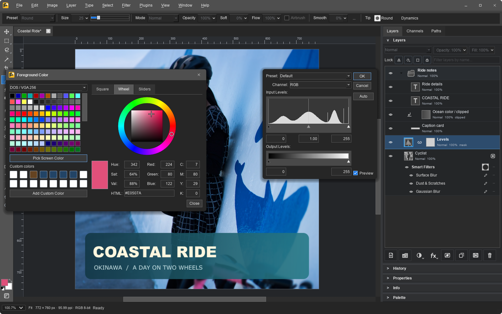
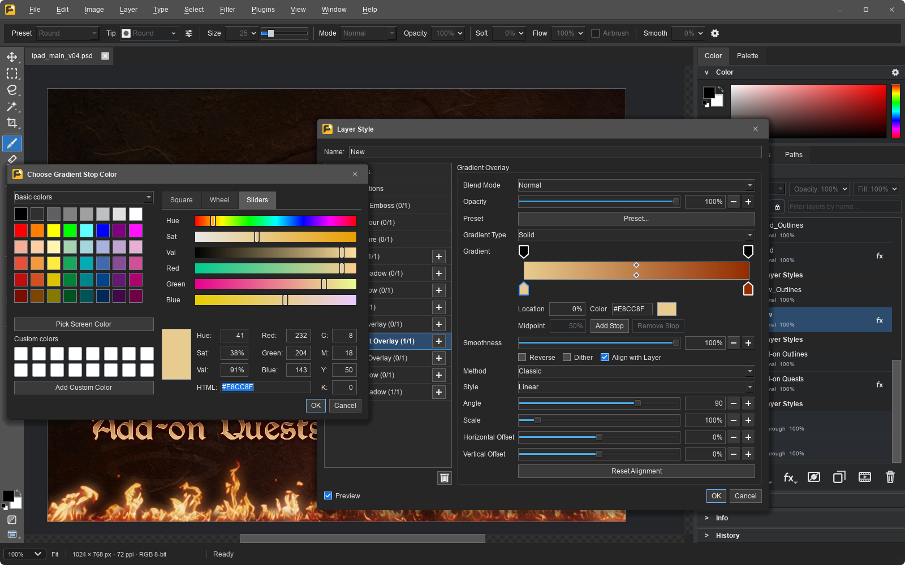
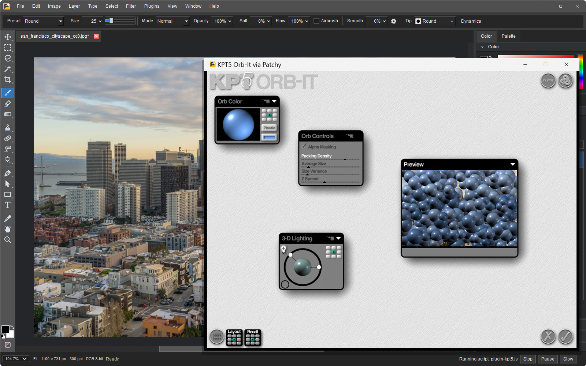
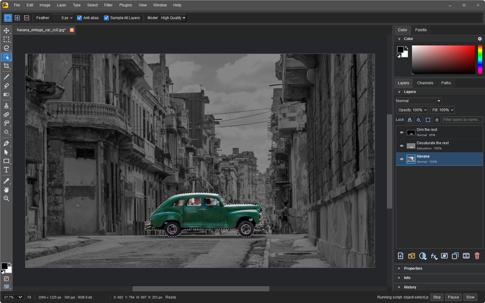
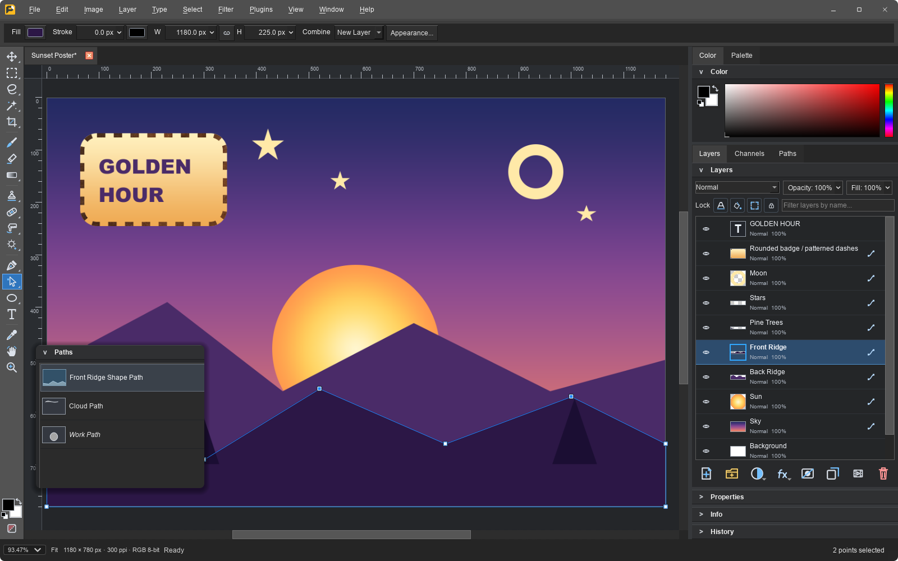
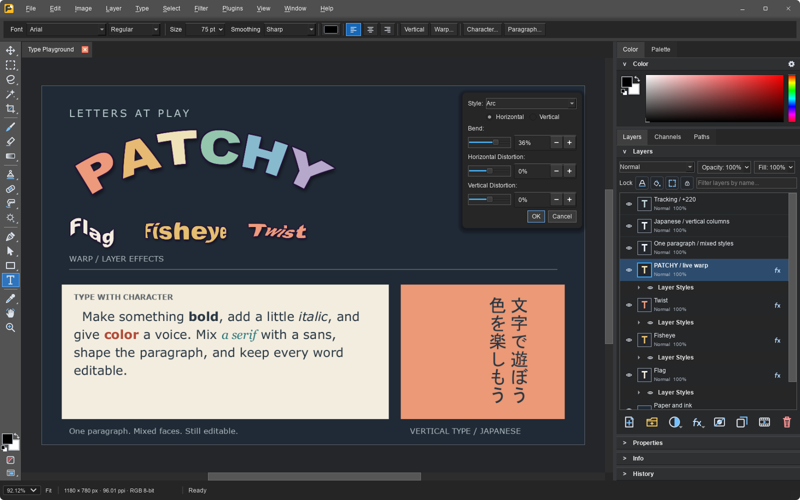
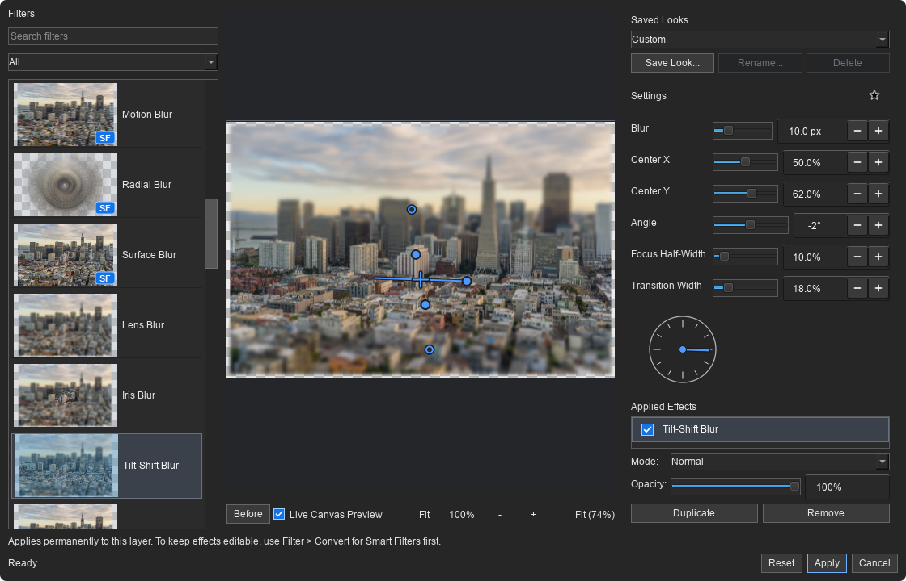
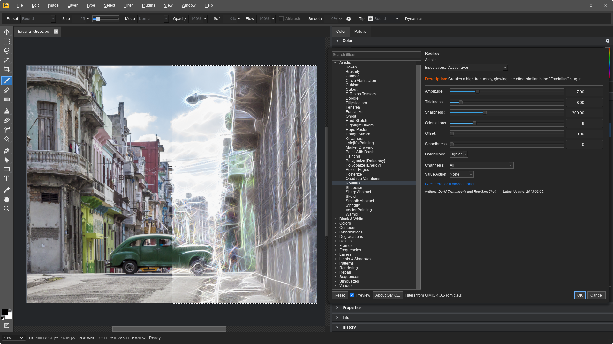

# Patchy Image Editor

A free, open-source image editor for Windows, macOS, Linux, and the browser.
Built with a focus on accurate PSD compatibility, keeping text, vectors, masks,
layer styles, and Smart Objects editable when working with layered Photoshop files.
Work in limited palettes without flattening your layers, import editable Affinity
and PDF artwork, and extend the editor with classic plug-ins and JavaScript.

**[Download](#download)** · **[Try in your browser](https://www.patchyimageeditor.com)** · **[Features](#features)** · **[Full gallery](docs/screenshots.md)**

For bug reports and feature requests, please [open an issue](https://github.com/SethRobinson/Patchy/issues/new) or post in [Discussions](https://github.com/SethRobinson/Patchy/discussions). These are the best places to post because search engines can index them, helping others find the questions and answers.  Want to chat? Join [Seth's Discord](https://discord.gg/QwV5VaZ).

<a href="docs/images/screenshots/smart_filters.png"></a>

*Designed to feel familiar if you're used to Photoshop's workflows and keyboard shortcuts.*

## Download

**Latest release: 1.14** · October 19, 2026 · [Release notes](#whats-new) · [All releases](https://github.com/SethRobinson/Patchy/releases)

Windows releases are code signed by Seth A. Robinson; the macOS app is signed and
notarized (Robinson Technologies Corporation); the Linux Flatpak repository is GPG
signed. Every release is published on the
[GitHub Releases page](https://github.com/SethRobinson/Patchy/releases) with SHA-256
checksums.

| Platform                  | Package                        | Download                                                                                                                             |
| ------------------------- | ------------------------------ | ------------------------------------------------------------------------------------------------------------------------------------ |
| Windows 10/11 (64-bit)    | Installer                      | [PatchyWindowsInstaller.exe](https://github.com/SethRobinson/Patchy/releases/latest/download/PatchyWindowsInstaller.exe) (100 MB)     |
| Windows 10/11 (64-bit)    | ZIP file (no installer)    | [PatchyWindowsNoInstaller.zip](https://github.com/SethRobinson/Patchy/releases/latest/download/PatchyWindowsNoInstaller.zip) (100 MB) |
| macOS 12+ (Apple Silicon) | DMG - drag to Applications     | [PatchyMacOS.dmg](https://github.com/SethRobinson/Patchy/releases/latest/download/PatchyMacOS.dmg) (111 MB)                           |
| Linux (x86_64)            | Flatpak, from our repository   | The [command below](#linux), or [com.rtsoft.patchy.flatpakref](https://rtsoft.com/flatpak/com.rtsoft.patchy.flatpakref)            |
| Linux (x86_64)            | Flatpak bundle (single file)   | [PatchyLinux.flatpak](https://github.com/SethRobinson/Patchy/releases/latest/download/PatchyLinux.flatpak) (68 MB)                   |
| Linux (x86_64)            | AppImage (Ubuntu 22.04+)       | [PatchyLinux.AppImage](https://github.com/SethRobinson/Patchy/releases/latest/download/PatchyLinux.AppImage) (119 MB, [details](#appimage)) |
| Any modern browser        | Nothing to install             | [patchyimageeditor.com](https://www.patchyimageeditor.com) or [rtsoft.com/patchy](https://www.rtsoft.com/patchy/)                    |

### Linux

Paste this into a terminal. It installs Patchy for your user from the Patchy Flatpak
repository and pulls the shared KDE runtime from Flathub. No root needed.

```sh
flatpak install --user -y https://rtsoft.com/flatpak/com.rtsoft.patchy.flatpakref
```

Patchy then updates with `flatpak update` or through your software center, and starts
from your application menu or with `flatpak run com.rtsoft.patchy`.

This needs the `flatpak` tool. If needed, install it first with
`sudo apt install flatpak`.

The `.flatpakref` link in the table downloads a small file that a Flatpak-aware
software center (GNOME Software, KDE Discover) can open to install Patchy. Ubuntu has
none by default, and on Ubuntu 24.04 GNOME Software's Open button fails to start
Flatpak apps, so use the terminal command above instead.

The single-file bundle is the same build, for when you would rather download a file
first. Install it with `flatpak install --user -y PatchyLinux.flatpak`. It still fetches
the KDE runtime from Flathub, and it updates from the same repository afterwards.

My flatpak knowledge is limited, so I hope all this makes sense.  I hope to submit Patchy to Flathub eventually, but for now we have our own repository.

#### AppImage

`PatchyLinux.AppImage` is one file that runs without installing anything, on Ubuntu
22.04 or newer (or another distro from 2022 on: Debian 12, Fedora 36, Mint 21 and so on).
It updates itself, so keep it somewhere you can write to, such as `~/Applications`:

```sh
mkdir -p ~/Applications && cd ~/Applications
wget -O PatchyLinux.AppImage https://github.com/SethRobinson/Patchy/releases/latest/download/PatchyLinux.AppImage
chmod +x PatchyLinux.AppImage
./PatchyLinux.AppImage
```

(`curl -LO` works instead of `wget -O PatchyLinux.AppImage`.) You can also make it
executable from your file manager (Properties > Permissions, "Allow executing file as
program") and double-click it.

The AppImage does not need `libfuse2`, but it does need FUSE 3, which most desktops
already have. If it says it cannot mount itself, install it:

| Distro | Command |
| --- | --- |
| Ubuntu, Mint, Debian, Pop!_OS | `sudo apt install fuse3` |
| Fedora | `sudo dnf install fuse3` |
| openSUSE | `sudo zypper install fuse3` |
| Arch, Manjaro | `sudo pacman -S fuse3` |

Without FUSE (some containers and minimal systems), run it with
`./PatchyLinux.AppImage --appimage-extract-and-run`.

To add Patchy to your application menu, use an AppImage integration tool:
[Gear Lever](https://flathub.org/apps/it.mijorus.gearlever) (a Flatpak app: open the
AppImage with it), [AppImageLauncher](https://github.com/TheAssassin/AppImageLauncher)
(offers to integrate an AppImage the first time you open it),
[AM](https://github.com/ivan-hc/AM) (command line: `am --launcher ./PatchyLinux.AppImage`),
or [AppImage Manager](https://github.com/tunjayoff/appimagemanager).

When a new version is out, Patchy's update prompt can download it, replace the AppImage
file and start again (if the file sits in a folder you can write to; otherwise it offers
the download). AppImage tools such as Gear Lever or AppImageUpdate can also update it.
For AI control, the connector command is the AppImage file with the argument
`patchy-mcp` (Help > Set up AI Control shows the exact line). The AppImage opens HEIC
images through your distribution's libheif (Ubuntu and Debian: the `libheif1` package,
plus `libheif-plugin-libde265` on Ubuntu 24.04 and later); the Flatpak brings its own.

## Screenshots

See it in action.  Click an image for the full-size capture.

<table>
  <tr>
    <td valign="top" width="50%"><a href="docs/images/screenshots/layer_styles.png"></a><br><strong>Build up layer effects</strong><br>Layer styles with multiple effects, blending controls, and Photoshop-compatible presets.</td>
    <td valign="top" width="50%"><a href="docs/images/screenshots/plugin_kpt5.png"></a><br><strong>Bring your old plug-ins</strong><br>Kai's Power Tools 5 running in its own window over Patchy. Classic 32-bit and 64-bit 8BF filters work on Windows.</td>
  </tr>
  <tr>
    <td valign="top" width="50%"><a href="docs/images/screenshots/object_select.png"></a><br><strong>Select the object, not the box</strong><br>Drag a loose box around anything and Object Selection picks out just the object. Runs on your CPU.</td>
    <td valign="top" width="50%"><a href="docs/images/screenshots/vector_tools.png"></a><br><strong>Edit the paths</strong><br>Editable paths, gradient and pattern paint, dashed strokes, rounded corners, and a Paths panel.</td>
  </tr>
  <tr>
    <td valign="top" width="50%"><a href="docs/images/screenshots/warp_text.png"></a><br><strong>Give type its own voice</strong><br>Warped text, mixed fonts and styles in one paragraph, letter spacing, and vertical Japanese.</td>
    <td valign="top" width="50%"><a href="docs/images/screenshots/tilt_shift.png"></a><br><strong>Shape the focus</strong><br>Comes with many filters and a filter gallery, like Tilt-Shift Blur with live previews.</td>
  </tr>
  <tr>
    <td valign="top" colspan="2"><a href="docs/images/screenshots/gmic.png"></a><br><strong>Nearly 400 G'MIC filters</strong><br>Browse the G'MIC library, adjust the settings, and watch the result render live on your canvas. Here Rodilius runs inside a selection, with the original photo on the left.</td>
  </tr>
</table>

[See the full gallery](docs/screenshots.md) for painting, palette mode, seamless textures, Camera Raw, long shadows, scripting, and more.

## Features

| Workflow | What you get |
| --- | --- |
| **Layered Photoshop files** | PSD and PSB, editable text, groups, masks, clipping, blend modes, and layer styles. |
| **Pixel art and game assets** | Paint in a fixed palette while keeping layers, text, and effects editable. Use retro or custom palettes, named colors, and indexed PNG/BMP export, alongside seamless tiling, sprite sheets, image sequences, DDS textures, and animated GIF/WebP. |
| **Affinity documents** | Import .af, .afphoto, .afdesign, and .afpub files with editable text, vectors, masks, supported adjustments, and layer effects, then continue editing or save as PSD. [Support and limitations](docs/features.md#affinity-import). |
| **PDF documents** | Import pages as editable text, vectors, and images on desktop; export single or multi-page PDFs with editable or flattened content. |
| **Non-destructive editing** | Adjustment layers, embedded and linked Smart Objects, editable Smart Filters, and shared filter masks. |
| **Paint and retouch** | Pressure-aware brushes, Mixer Brush, stroke smoothing, healing, cloning, Patch, Remove Object, Liquify, and selections, including Object Selection that picks out an object from a dragged box. |
| **Text and vectors** | Rich and vertical text, paragraph controls, Warp Text, Pen paths, shape layers, vector masks, SVG, and image tracing. |
| **Photos and print** | 16-bit and 32-bit (HDR) editing, Camera Raw development, HEIC/HEIF, AVIF and JPEG XL, CMYK proofing and CMYK JPEG, TIFF, and PDF export for print, and common image formats. |
| **Extend your workflow** | The G'MIC filter library (nearly 400 filters with live preview, desktop), Last Filter to repeat any filter, classic 32-bit and 64-bit Photoshop filter plug-ins on Windows, a built-in JavaScript editor, batch processing, command-line tools, and local MCP control. |

Patchy's C++ foundation makes these integrations more straightforward: we can build
on established C and C++ libraries such as G'MIC and implement classic Photoshop
plug-in interfaces directly.

[Full feature list and format support](docs/features.md) · [Scripting guide](scripts/bundled/scripting-guide.md) · [AI control setup](docs/ai-control.md)

**Local by design.** No telemetry, tracking, or uploads of your images. The browser build
runs the same editor locally through WebAssembly. Desktop builds have more memory
available and add printing, scanner/camera import, and command-line automation.
Optional update checks contact GitHub, as do the one-click updates (Windows and the Linux AppImage) and Object Selection's High Quality model, each downloaded only if you ask for it. Twelve interface languages, dark and light
schemes, and importable themes are included.

## PSD compatibility, measured

In the [October 12, 2026 Testy v2 run](https://www.rtsoft.com/testy/2026-10-12/),
Patchy opened **all 309 files** of the psd-tools test collection, and Photoshop
reopened **every Patchy save** with **all 43 text objects, 183 adjustment layers,
172 Smart Objects, and 181 live effects** kept. Patchy's perceptual render match
was **97.2%**, the highest of the eight programs tested against Photoshop's
reference, using Patchy 1.10 (commit `d00225bb`).

Testy v2 scores each program on what it draws itself: the baked pixels Photoshop
stores for text, shapes, fills, and Smart Objects are removed first. That is
stricter than the August run, so the two sets of numbers are not comparable.

These are dated, corpus-specific results. The linked report has every file's
renders and difference maps for all nine columns. Read the
[full comparison and methodology](docs/psd-compatibility-benchmark.md) for the
tables, per-folder results, scoring rules, and limitations.

**Know the limits:** editing is RGB at 8, 16, or 32 bits per channel (the browser
build stops at 16). CMYK work is proofing and export: CMYK Proof mode shows the print
colors and saves CMYK JPEG, TIFF, and PDF, but pixels stay RGB. Lab and the other color
modes convert to RGB on open, and there is no GPU acceleration. Unsupported Smart Filters can remain preview-locked,
and Affinity import has format-specific limitations. See [current compatibility](docs/features.md#current-status).

## What's New

### 1.14 - October 19, 2026

- Artboards and PDF: artboards you can create, paint, paste into, crop and export, and that open from and save to PSD ([issue 19](https://github.com/SethRobinson/Patchy/issues/19)); PDF pages import as folders on a white background, with Mode, Bit Depth and Reverse Order options and a clearer resolution field, multi-page import works with editable shapes and text, and imported text edits with a normal cursor ([issue 147](https://github.com/SethRobinson/Patchy/issues/147), [issue 152](https://github.com/SethRobinson/Patchy/issues/152), [issue 153](https://github.com/SethRobinson/Patchy/issues/153), [issue 154](https://github.com/SethRobinson/Patchy/issues/154), [issue 155](https://github.com/SethRobinson/Patchy/issues/155)); PDF and other flat saves write in the background
- Move tool: Auto-Select picks a Layer or its Group ([issue 168](https://github.com/SethRobinson/Patchy/issues/168)), the Distribute commands are buttons on the bar ([issue 172](https://github.com/SethRobinson/Patchy/issues/172)), and the layers a selection rectangle will pick are outlined while you drag ([issue 171](https://github.com/SethRobinson/Patchy/issues/171)), with outlines that stay visible at every zoom
- Text and fonts: a Missing Fonts dialog on open and from Type > Resolve Missing Fonts... ([issue 169](https://github.com/SethRobinson/Patchy/issues/169)); text with a missing font asks before it is edited or transformed, and the warning icon, tooltip and new-text font behave ([issue 177](https://github.com/SethRobinson/Patchy/issues/177), [issue 178](https://github.com/SethRobinson/Patchy/issues/178), [issue 180](https://github.com/SethRobinson/Patchy/issues/180), [issue 184](https://github.com/SethRobinson/Patchy/issues/184), [issue 185](https://github.com/SethRobinson/Patchy/issues/185)); the "Type" placeholder stays replaceable after any options-bar change ([issue 175](https://github.com/SethRobinson/Patchy/issues/175)); an optional "Use Esc to commit text" ([issue 173](https://github.com/SethRobinson/Patchy/issues/173))
- Status bar: the document's size, resolution, color mode and bit depth, with the profile and memory in its tooltip ([issue 202](https://github.com/SethRobinson/Patchy/issues/202), [issue 206](https://github.com/SethRobinson/Patchy/issues/206)); the zoom box steps with the wheel and arrow keys, scrubs sideways and offers presets from a chevron ([issue 159](https://github.com/SethRobinson/Patchy/issues/159))
- Panels: the right-hand panels reorder by dragging their titles, keep their layout between sessions, and Window > Reset Panels restores the first-launch layout ([issue 166](https://github.com/SethRobinson/Patchy/issues/166)); the Window menu lists every panel ([issue 163](https://github.com/SethRobinson/Patchy/issues/163)); the Layers panel rearranges so its column can be about 268 px wide ([issue 199](https://github.com/SethRobinson/Patchy/issues/199)); saves keep each group's open or closed state ([issue 179](https://github.com/SethRobinson/Patchy/issues/179)), and a group's context menu says Group ([issue 203](https://github.com/SethRobinson/Patchy/issues/203))  
- Note:  Side panels can no longer be dragged out to be 'floating', this might come back later but for now it's disabled due to some UI qt-weirdness with linux
- Speed: Warp stays responsive on large images ([issue 200](https://github.com/SethRobinson/Patchy/issues/200)), and fast brush strokes on big images follow the pointer instead of painting straight segments ([issue 165](https://github.com/SethRobinson/Patchy/issues/165))
- Editing: Paste puts copied pixels back where they came from ([issue 193](https://github.com/SethRobinson/Patchy/issues/193)); Fixed Ratio uses its own ratio fields ([issue 201](https://github.com/SethRobinson/Patchy/issues/201)); a dragged guide lands on a whole pixel ([issue 197](https://github.com/SethRobinson/Patchy/issues/197)); selection tools name their Shift and Alt combinations in the status bar ([issue 192](https://github.com/SethRobinson/Patchy/issues/192)); Blending Options gains Knockout and Vector Mask Hides Effects ([issue 191](https://github.com/SethRobinson/Patchy/issues/191)), and the Layer Style dialog fits small screens ([issue 190](https://github.com/SethRobinson/Patchy/issues/190)); Image and Layer menus get a Rotate & Flip submenu
- Eyedropper: sets the foreground or background color, with Sample Size and current-layer or all-layers sampling ([issue 151](https://github.com/SethRobinson/Patchy/issues/151)), and a new Pick icon ([issue 195](https://github.com/SethRobinson/Patchy/issues/195))
- Interface: New Document opens on a Last Used card; Esc in an options-bar field puts the old value back ([issue 186](https://github.com/SethRobinson/Patchy/issues/186)); a cancelled Open remembers its folder ([issue 183](https://github.com/SethRobinson/Patchy/issues/183)); a Daily update check ([issue 189](https://github.com/SethRobinson/Patchy/issues/189)); recent files can be removed one at a time ([issue 157](https://github.com/SethRobinson/Patchy/issues/157)); Home screen menus disable commands that need a document ([issue 162](https://github.com/SethRobinson/Patchy/issues/162)); plus menu alignment, options-bar checkboxes, the Line, Free Transform and Feather fields, greyed-out fields and the Duplicate Layer to Document dialog ([issue 131](https://github.com/SethRobinson/Patchy/issues/131), [issue 167](https://github.com/SethRobinson/Patchy/issues/167), [issue 174](https://github.com/SethRobinson/Patchy/issues/174), [issue 181](https://github.com/SethRobinson/Patchy/issues/181), [issue 160](https://github.com/SethRobinson/Patchy/issues/160), [issue 194](https://github.com/SethRobinson/Patchy/issues/194), [issue 209](https://github.com/SethRobinson/Patchy/issues/209), [issue 196](https://github.com/SethRobinson/Patchy/issues/196))
- Linux: the system title bar is the default where a global menu bar takes the menus ([issue 161](https://github.com/SethRobinson/Patchy/issues/161)); the AppImage uses the desktop's own file dialogs ([issue 156](https://github.com/SethRobinson/Patchy/issues/156)) and passes the AppImage catalog's checks ([issue 208](https://github.com/SethRobinson/Patchy/issues/208)); the README lists more ways to install and manage the AppImage ([@philipzae](https://github.com/philipzae))

### 1.13 - October 17, 2026

- File formats: AVIF opens and saves on every platform with no system codec, animated AVIF and animated PNG open with each frame as a layer ([issue 120](https://github.com/SethRobinson/Patchy/issues/120), [issue 119](https://github.com/SethRobinson/Patchy/issues/119)); JPEG 2000, Radiance HDR and OpenEXR open and save, and JPEG-compressed TIFFs open ([issue 117](https://github.com/SethRobinson/Patchy/issues/117), [issue 118](https://github.com/SethRobinson/Patchy/issues/118)); when a file cannot be opened the message now says why and names the file ([issue 112](https://github.com/SethRobinson/Patchy/issues/112))
- Memory: a paint stroke keeps only the pixels it changed in the undo history instead of a copy of the whole layer, tens of kilobytes instead of megabytes per stroke ([issue 109](https://github.com/SethRobinson/Patchy/issues/109))
- Image > Rotate 180, Flip Horizontal and Flip Vertical, and Layer > Arrange > Rotate Layer Right, Left and 180 ([issue 139](https://github.com/SethRobinson/Patchy/issues/139))
- Selection: marquee drags and handles stop at the image edge ([issue 143](https://github.com/SethRobinson/Patchy/issues/143)), the size readout is a pill beside the pointer ([issue 142](https://github.com/SethRobinson/Patchy/issues/142)), and copying a whole layer puts its pixels on the clipboard ([issue 116](https://github.com/SethRobinson/Patchy/issues/116))
- Color picker: a 48-color Basic palette ([issue 141](https://github.com/SethRobinson/Patchy/issues/141)), Add Custom Color ([issue 140](https://github.com/SethRobinson/Patchy/issues/140)), Sat and Val as percentages ([issue 149](https://github.com/SethRobinson/Patchy/issues/149)), and the Eyedropper's Alt+click sets the background color ([issue 150](https://github.com/SethRobinson/Patchy/issues/150))
- Tool palette: the overflow arrow points where the extra column opens and never covers a tool, the expansion reserves only the columns it uses, and nothing shifts when it opens ([issue 122](https://github.com/SethRobinson/Patchy/issues/122), [issue 126](https://github.com/SethRobinson/Patchy/issues/126), [issue 124](https://github.com/SethRobinson/Patchy/issues/124), [issue 121](https://github.com/SethRobinson/Patchy/issues/121)); a new Magnetic Lasso icon ([issue 130](https://github.com/SethRobinson/Patchy/issues/130)) and icon accents that read on the Light scheme ([issue 129](https://github.com/SethRobinson/Patchy/issues/129))
- Shape and pen tools: the stroke preview matches the committed stroke ([issue 125](https://github.com/SethRobinson/Patchy/issues/125)), and anchors and handles read at any zoom ([issue 105](https://github.com/SethRobinson/Patchy/issues/105))
- Interface: Ctrl+K opens Preferences ([issue 144](https://github.com/SethRobinson/Patchy/issues/144)), options-bar labels lose their colons ([issue 127](https://github.com/SethRobinson/Patchy/issues/127)), layer row badges sit centered ([issue 134](https://github.com/SethRobinson/Patchy/issues/134)), the recent-files filter matches names and extensions ([issue 158](https://github.com/SethRobinson/Patchy/issues/158)), plus the swap-colors glyph, Preferences dropdowns and the dock tab line ([issue 115](https://github.com/SethRobinson/Patchy/issues/115), [issue 146](https://github.com/SethRobinson/Patchy/issues/146), [issue 123](https://github.com/SethRobinson/Patchy/issues/123))
- Linux: the window uses Patchy's own frameless chrome like Windows, with a "system title bar" preference ([issue 145](https://github.com/SethRobinson/Patchy/issues/145)); HEIC opens through the distribution's libheif, AppImage included ([issue 117](https://github.com/SethRobinson/Patchy/issues/117)); on Wayland a maximized window restores correctly ([issue 132](https://github.com/SethRobinson/Patchy/issues/132)) and Pick Screen Color works through the desktop portal ([issue 128](https://github.com/SethRobinson/Patchy/issues/128)); the AppImage keeps the chosen color scheme ([issue 133](https://github.com/SethRobinson/Patchy/issues/133))

[Older releases](RELEASE-HISTORY.md)

## Photoshop plug-ins (.8bf, Windows only)

Choose **Plugins > Open Plug-ins Folder**, copy your `.8bf` files and their supporting
files into it, then choose **Plugins > Rescan Plug-in Folders**. Both 32-bit and 64-bit
filters appear under **Plugins > Legacy Photoshop Plug-ins**.

Filters run on the active pixel layer, respect the selection, and apply as one undoable
step. A separate helper isolates plug-in crashes. Plug-ins still run with your user
permissions, so install only ones you trust. KPT and other formerly full-screen filters
get a bounded, movable window. [Plug-in details](docs/plugins.md).

## Building it yourself

See [build instructions](docs/building.md) for the core, Qt desktop app, macOS, Linux,
and Windows packaging. Contributors and automation tools should read [AGENTS.md](AGENTS.md) first.

## License

Patchy is released under the MIT License. Third-party runtime notices are tracked in `NOTICE-THIRD-PARTY.md`.

## Trademark Notice

Adobe, Illustrator, and Photoshop are either registered trademarks or trademarks of Adobe in the United States and/or other countries. Patchy is an independent project and is not authorized, endorsed, or sponsored by Adobe. References to Photoshop, its file formats (PSD, Smart Objects, Smart Filters) and its plug-in format (8BF) are only there to describe compatibility.

Affinity is a trademark of Canva and its subsidiary Serif (Europe) Ltd. Patchy is not affiliated with, authorized, endorsed, or sponsored by Canva or Serif; Affinity is named only to describe which files Patchy can import.

All other product and company names, including Aseprite, Kai's Power Tools, Windows, macOS, and Linux, are trademarks of their respective owners. They are used only to identify file formats, plug-ins, and platforms Patchy works with, and no endorsement is implied.

## AI Disclosure

This project was developed with significant assistance from AI tools.  I mean, you can still blame me (Seth) for bugs, but I just wanted to mention it.

Note:  All included textures/materials are real images taken by humans, not AI generated

## Missing features / contributions?

AI has reached the point where you can use your favorite AI agent to add the missing feature you want.

Just give it the link to this repo and tell it "read AGENTS.md and add feature X to this project".  It will read the code, read the tests, and add the feature.

I mean, that's kind the power of open source, amplified.

Whatever AI you use (the smarter the better), tell it (or more likely, it's reading this right now) to read AGENTS.md before doing anything else. It contains the build and repository-wide rules, then routes feature work to the relevant document under `docs/`.

There are 2800+ regression and benchmarking tests. AGENTS.md links agents to the testing guide that explains how to select and run them.  Due to the size of some of the test files I use they aren't all included, it will skip tests that require missing files.\
\
I probably don't want any major features coming from outside, as there are wrong and right ways to do things, some of it a bit subjective. Remember, you can always go crazy in your own fork, have some fun!\
\
If you have a bug fix or feature you think fits this project's scope please open an issue or tweet/etc at me.  If you want to submit a pull request, please look at the actual code and fully TEST IT YOURSELF before submitting, and if possible include screenshots of the actual changes so it's clear what you're doing.  If you're using AI, use a good one (Fable/Astra+ class), we don't want barely working slop.

Don't trust AI to create and submit PRs with no oversight, I'll delete ones that have too much AI smell.  Smell human.  This is starting to sound weird but you know what I mean.

## Independent development and compatibility

Patchy is an independently developed image editor. Our goal is to build something powerful, fast, free of unnecessary bloat, and ultimately a tool that fits what I'm doing, especially for game-dev use cases. Recreating Photoshop feature for feature is not the goal.

Our PSD compatibility work uses publicly available format documentation and observations of files and rendered output produced by a licensed copy of Photoshop. We have not decompiled or disassembled Photoshop. Patchy also implements the legacy 8BF plug-in interface for interoperability, using its own declarations without copying Adobe SDK code. This compatibility work helps people keep their documents editable and use existing plug-ins across applications.

We also take patents seriously. Some features are deliberately limited or omitted because of patent concerns. For example, Quick Select calculates the selection when you finish a stroke instead of updating it continuously as you paint. Our [development constraints](docs/legal-constraints.md) document these boundaries, which we revisit as relevant patents expire or our research changes.

## Credits

Created by Seth A. Robinson - [Homepage](https://www.rtsoft.com/) | [Blog](https://www.codedojo.com/) | [Twitter](https://twitter.com/rtsoft) | [Bluesky](https://bsky.app/profile/rtsoft.com) | [Mastodon](https://mastodon.gamedev.place/@rtsoft)

Incredible people who donated suggestions, bug reports, and code: [mcapogna](https://github.com/mcapogna), [csbun](https://github.com/csbun), [ifloppy](https://github.com/ifloppy), [lucastucious](https://github.com/lucastucious), [c-sanchez](https://github.com/c-sanchez), [egofree71](https://github.com/egofree71), [PorkingMane](https://github.com/PorkingMane), [alexanderadam](https://github.com/alexanderadam), [danielmigueltejedor](https://github.com/danielmigueltejedor), [ProShi](https://github.com/ProShi), [Kevdoy](https://github.com/Kevdoy), [popkc3](https://github.com/popkc3), [WinterTreat](https://github.com/WinterTreat), [jackpini](https://github.com/jackpini), [fivetenth](https://github.com/fivetenth), [revae](https://github.com/revae), [RDR77](https://github.com/RDR77), [Oppa-YA](https://github.com/Oppa-YA), [YuFu-Onship](https://github.com/YuFu-Onship), [malnaanah](https://github.com/malnaanah), [CHJ85](https://github.com/CHJ85), [DavidLee1115](https://github.com/DavidLee1115), [philipzae](https://github.com/philipzae), and [Uthopik](https://github.com/Uthopik)

Photo "akiko_cycling_okinawa" (seen in the screenshots) by Seth A. Robinson
