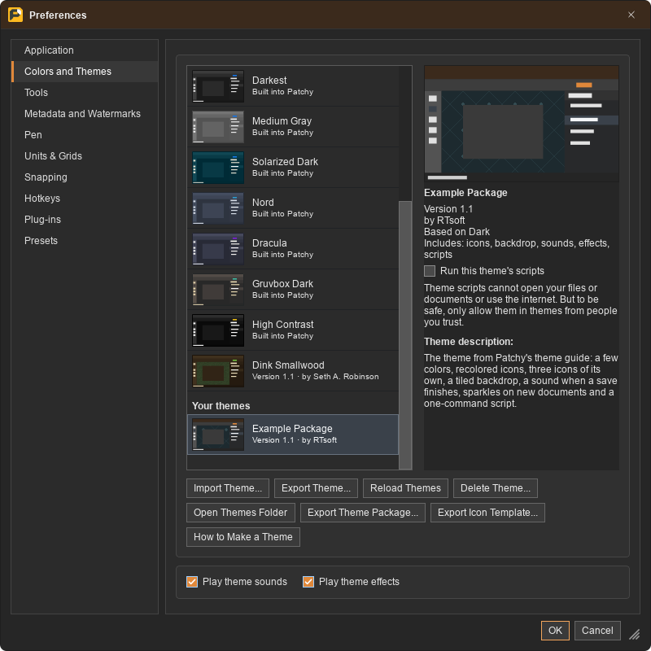
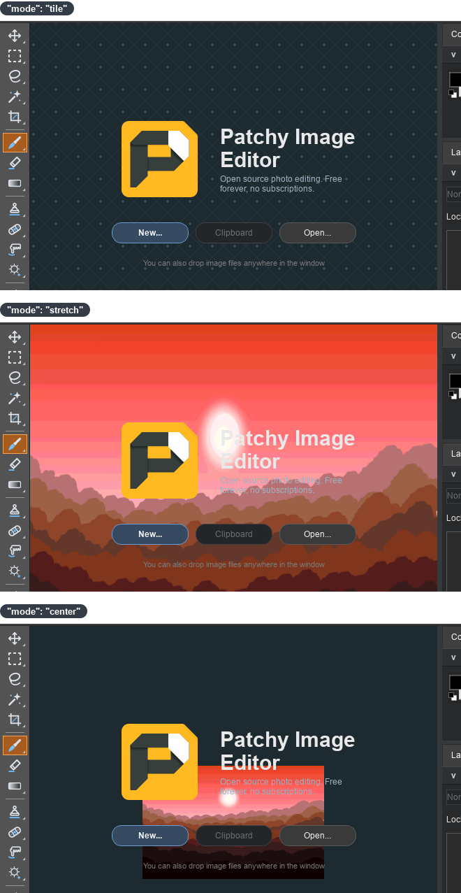
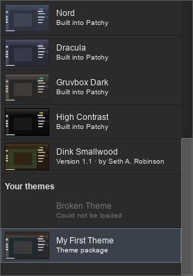

# Theme reference

The second page of [Making a Patchy theme](making-themes.md). The first page builds a small theme step by step; this one lists everything a theme can hold. Sounds, effects and scripts have [their own page](making-themes-sounds-scripts.md).

- [What a theme is made of](#what-a-theme-is-made-of)
- [theme.json](#themejson)
- [Colors](#colors)
- [Icons](#icons)
- [The backdrop](#the-backdrop)
- [Panel backgrounds, cursors and a splash picture](#panel-backgrounds-cursors-and-a-splash-picture)
- [Sharing a theme](#sharing-a-theme)
- [Limits](#limits)
- [Troubleshooting](#troubleshooting)

## What a theme is made of

Patchy reads three kinds of theme from the themes folder (Preferences > Colors and Themes > **Open Themes Folder**):

| Kind | What it is | Good for |
| --- | --- | --- |
| `Name.patchytheme` | One text file | Colors only |
| A folder with `theme.json` in it | A theme package | Everything; the kind to work in |
| `Name.zip` | A theme package, zipped | Sharing |

A package looks like this. Only `theme.json` is required:

```text
My Theme/
  theme.json            colors and settings
  icons/                your icons, named like the ones they replace
    tool-brush.svg
    tool-eraser.png
    tool-eraser@2x.png
  images/               the backdrop and any other picture theme.json names
    backdrop.png
  sounds/               one WAV file per event
    save-done.wav
  scripts/
    main.js             the theme script
```

Patchy reads `theme.json` and those four folders and nothing else, so a README or your working files can sit beside them. Paths written in `theme.json` and in scripts start at the theme folder and use forward slashes: `images/backdrop.png`.

The folder's name is how Patchy remembers the theme. Rename the folder and Patchy treats it as a new theme: select it again, and allow its scripts again.

While a theme folder is the theme showing (selected in Preferences or in use), Patchy watches it and reloads it a moment after any file in it changes. A save that leaves `theme.json` broken is ignored until the file is valid again. Zips and `.patchytheme` files are not watched: use **Reload Themes** for those.

## theme.json

A complete `theme.json`, with every setting this page covers:

```json
{
  "format": 1,
  "name": "Example Package",
  "version": "1.1",
  "author": "RTsoft",
  "description": "A small theme that shows what a package can hold.",
  "minPatchyVersion": "1.36",
  "base": "dark",
  "recolorIcons": false,
  "iconScaling": "nearest",
  "backdrop": { "image": "images/backdrop.png", "mode": "tile" },
  "roles": {
    "accent": "#e0883a",
    "canvas_backdrop": "#1d2a2f"
  }
}
```

| Key | Value | Meaning |
| --- | --- | --- |
| `base` | `"dark"` or `"light"` | Required. The built-in scheme every unset color comes from. |
| `name` | text | The name in the theme list. Without it the list shows the folder or file name. |
| `roles` | `{ "role": "#RRGGBB" }` | The colors you change. See [Colors](#colors). |
| `version` | text, up to 32 characters | Your theme's version, shown in the list. |
| `author` | text, up to 100 characters | Shown in the list as "by ...". |
| `description` | text, up to 2000 characters | Shown in the details when the theme is selected. Line breaks (`\n`) are kept. |
| `minPatchyVersion` | a version such as `"1.36"` | The oldest Patchy the theme is made for. An older Patchy still loads the theme but tells the user that parts may not work. |
| `format` | `1` | Optional. The file format; leave it at 1 or leave it out. |
| `recolorIcons` | `true` (default) or `false` | Whether the template colors in your SVG icons are swapped for the theme's icon colors. See [Icons](#icons). |
| `iconScaling` | `"smooth"` (default) or `"nearest"` | How PNG and BMP icons are scaled. `"nearest"` keeps pixel art hard-edged. |
| `backdrop` | `{ "image": ..., "mode": ... }` | A picture behind the canvas. See [The backdrop](#the-backdrop). |
| `panelBackgrounds`, `cursors`, `splash` | objects | See [below](#panel-backgrounds-cursors-and-a-splash-picture). |
| `events` | object | Sounds and effects for events. See [Sounds, effects and scripts](making-themes-sounds-scripts.md). |
| `menuTitle` | text | The title of the menu a theme script adds. See [Theme scripts](making-themes-sounds-scripts.md#theme-scripts). |

`theme.json` is strict JSON: double quotes around every name and text value, a comma between entries, no comma after the last one, and no comments.

The name, author and description are shown as plain text. The theme list shows the version and author under the name, and the details show what the package includes:



## Colors

Each entry in `"roles"` is a role name and a color: `"#RRGGBB"`, or `"#RRGGBBAA"` with transparency. Other spellings (`"orange"`, `"#fa0"`, `"rgb(...)"`) are an error and the theme does not load. Most surfaces are solid, so transparency rarely shows.

There are about 360 roles. To get them all with their current colors, select a theme and click **Export Theme**: the `.patchytheme` file it writes lists every one. A role you leave out keeps the color of your `"base"` scheme. A role name Patchy does not know is skipped, so a theme made for a newer Patchy still loads in an older one.

### The roles most themes change

| Role | What it colors |
| --- | --- |
| `window_bg` | The main window behind everything |
| `window_border` | Lines between areas of the window |
| `text_primary`, `text_secondary`, `text_disabled` | Text, dimmer text, greyed-out text |
| `accent` | The highlight color: slider fills, check marks, the selected page's marker |
| `accent_pressed_bg`, `accent_border_bright` | Pressed-in tool buttons, such as the selected tool |
| `accent_checked_bg`, `accent_checked_border` | Switched-on buttons in the options bar |
| `text_on_accent` | Text drawn on the accent color |
| `title_bar_bg` | The title bar with the menus |
| `menu_bg`, `menu_item_selected_bg` | Menus and the entry under the pointer |
| `options_bar_bg` | The options bar under the title bar |
| `tool_palette_bg` | The tool palette |
| `panel_bg`, `dock_title_bg`, `panel_title_bg` | Panels and their title rows |
| `button_bg`, `button_hover_bg` | Buttons |
| `field_bg`, `field_border` | Text and number fields |
| `list_selection_bg`, `list_selection_text` | The selected row of a list |
| `layer_row_bg`, `layer_row_selected_bg`, `layer_row_selected_border` | Rows of the Layers panel and the selected one |
| `status_bar_bg`, `status_text` | The status bar |
| `canvas_backdrop` | The area around the document |
| `canvas_scrollbar_track` | The canvas scroll bars' track |

The small preview in the theme list is drawn from your own `window_bg`, `title_bar_bg`, `options_bar_bg`, `tool_palette_bg`, `panel_bg`, `accent`, `canvas_backdrop` and `status_bar_bg`, so it is a quick check that they loaded.

### Icon colors

The built-in icons are drawn in ten colors. Each has a role, and changing the role recolors every icon that uses it:

| Role | Color in the template files | Used for |
| --- | --- | --- |
| `icon_ink` | `#dce2eb` | Lines and shapes |
| `icon_accent` | `#74c0ff` | The highlighted part |
| `icon_accent_soft` | `#b8dcff` | A lighter highlight |
| `icon_accent_tint` | `#acd8ff` | A second lighter highlight |
| `icon_danger` | `#ff9696` | Delete and warning-red parts |
| `icon_warning` | `#ffc078` | Orange parts |
| `icon_folder` | `#f5cd69` | Folder outlines |
| `icon_folder_fill` | `#3a3320` | Folder fills |
| `icon_success` | `#9be9a8` | Green parts |
| `icon_surface` | `#242628` | Dark fills inside an icon |

## Icons

A file in the package's `icons` folder replaces the built-in icon of the same name. **Export Icon Template** in Preferences writes every replaceable icon as an SVG file, about 140 of them, so you have the names and a drawing to start from.

- The file name without its extension must match a template name exactly: `tool-brush.svg`, `tool-brush.png` or `tool-brush.bmp`.
- Files go directly in `icons`. Subfolders of `icons` are ignored, so they are a good place for working files.
- SVG icons scale to every size. The templates use `viewBox="0 0 32 32"`; any square viewBox works.
- PNG and BMP icons are fitted to the size Patchy needs, keeping their shape. Add `name@2x.png` at twice the size for high-resolution screens and large interface scales. One side may be at most 1024 pixels.
- JPEG is not accepted for icons.

### How SVG icons are recolored

With `"recolorIcons": true` (the default), Patchy looks in your SVG for the ten template colors in the table above, written exactly as shown (lowercase, six digits), and replaces each with the theme's color for that role. Every other color is drawn as it is. So:

- An edited template icon keeps following the theme, in dark and light themes alike.
- An icon in your own colors is simply drawn in those colors.
- If your artwork happens to use one of the ten colors and must not change, set `"recolorIcons": false`. That turns the swap off for all your SVG files. Patchy's own icons are still recolored by the icon roles.

PNG and BMP icons are never recolored.

### What an SVG icon may contain

A theme's SVG must be self-contained. Patchy leaves out, and keeps its own icon for, an SVG that:

- links to another file or a web address (an `href` that is not `#something`, a `url(...)` that is not `url(#something)`, or `@import`),
- has an `<image>` that is not embedded PNG or JPEG data,
- begins with a `<!DOCTYPE ...>` line or holds a `<?...?>` instruction other than the usual `<?xml ...?>` first line.

Gradients, clip paths and other references inside the same file are fine. If your drawing program adds a DOCTYPE line, delete that line or use its "plain SVG" or "optimized SVG" export.

### Icons a theme cannot replace

A few small marks are not in the template and always stay Patchy's: the check mark in checkboxes and menus, the arrows of number fields, the corner mark on tool buttons that have more tools, and some simple glyphs Patchy draws itself. They follow your `"base"` scheme.

## The backdrop

`"backdrop"` puts a picture behind the canvas (the area around the document) and behind the Home Screen:

```json
  "backdrop": { "image": "images/backdrop.png", "mode": "tile" }
```

| `mode` | Result |
| --- | --- |
| `"tile"` (default) | The picture repeats. Use a tile whose edges match; 32 to 256 pixels works well. |
| `"stretch"` | The picture is stretched to fill the area. |
| `"center"` | The picture sits in the middle at its own size, with `canvas_backdrop` around it. |



- The picture is a PNG, JPEG or BMP in the package, at most 8192 pixels a side.
- It stays fixed to the window: it does not move or scale when you pan and zoom the document.
- `canvas_backdrop` shows through transparent parts, so set it to a color that suits the picture.
- With a tiled backdrop the canvas scroll bars' track uses the tile too.
- A pasteboard color the user picked themselves (right-click the area around the document) wins over the picture.

## Panel backgrounds, cursors and a splash picture

Three more settings take pictures from the package. They work without scripts.

```json
  "panelBackgrounds": {
    "layers": { "image": "images/paper.jpg", "mode": "tile", "opacity": 0.25 },
    "dialogs": { "image": "images/stone.jpg" }
  },
  "cursors": {
    "crop": { "image": "images/sword-cursor.png", "hotX": 2, "hotY": 2 }
  },
  "splash": { "image": "images/splash.png", "ms": 1600 }
```

**`panelBackgrounds`** draws a faint picture behind a panel. The names are `layers`, `channels`, `paths`, `history`, `properties`, `info`, `palette`, `color`, `tools` (the tool palette) and `dialogs` (every dialog). `mode` is `tile` (default), `stretch` or `center`. `opacity` runs from 0.05 to 0.6 (default 0.3) in steps of 0.05; the picture is mixed into the panel's own color so text stays readable. Pictures may be up to 2048 pixels a side.

**`cursors`** replaces a tool's pointer with a picture of at most 128 pixels a side. `hotX` and `hotY` are the pixel of the picture that points. The names are the tool names: `move`, `marquee`, `elliptical_marquee`, `lasso`, `polygonal_lasso`, `magnetic_lasso`, `magic_wand`, `quick_select`, `object_select`, `crop`, `perspective_crop`, `eyedropper`, `ruler`, `brush`, `mixer_brush`, `eraser`, `fill`, `gradient`, `clone`, `pattern_stamp`, `healing`, `spot_healing`, `patch`, `content_aware_move`, `red_eye`, `color_replacement`, `smudge`, `blur`, `sharpen`, `dodge`, `burn`, `sponge`, `pen`, `add_anchor`, `delete_anchor`, `convert_point`, `path_select`, `direct_select`, `type`, `type_mask`, `rect`, `ellipse`, `polygon`, `line`, `custom_shape`, `artboard`, `hand`, `zoom`, `rotate_view`. Only a tool's plain pointer changes. Pointers that tell you something (resize and rotate handles, modifier keys, the outline of a brush) stay Patchy's, so a cursor suits tools such as Crop, the shape tools and Type better than the painting tools.

**`splash`** shows a picture in the middle of the window when Patchy starts with your theme, for `ms` milliseconds (500 to 6000, default 2500). A click closes it. The picture may be up to 2048 pixels a side.

All three take PNG, JPEG or BMP files. The bundled Dink Smallwood theme uses each of them: see [A full example](making-themes-sounds-scripts.md#a-full-example-dink-smallwood).

## Sharing a theme

**To share:** zip your theme folder. Either zip the folder itself or the files inside it; Patchy accepts `theme.json` at the top of the zip or inside one folder there. Name the zip after the theme.

**To install:** in Preferences > Colors and Themes click **Import Theme** and pick the `.zip` (or a `.patchytheme`). Patchy checks that it loads, copies it into the themes folder and selects it. If the package has a script, Patchy asks once whether to allow it. Copying the zip into the themes folder by hand and clicking **Reload Themes** does the same.

A zipped theme works exactly like the folder. To edit one you received, unzip it into the themes folder so it becomes a folder.

**Export Theme Package** saves the selected theme as a zip with a freshly written `theme.json` that lists every role. It is a quick way to turn any theme, a bundled one included, into a package you can unpack and study. At present it writes only the colors, the theme information, `recolorIcons`, `iconScaling` and `backdrop` into that `theme.json` (all the package's files are kept), and leaves out `events`, `menuTitle`, `cursors`, `panelBackgrounds` and `splash`. For a theme that uses those, zip the folder yourself.

**Delete Theme** removes the selected theme of yours: a file is deleted, a folder goes to the system trash.

If your theme uses other people's pictures, icons or sounds, check that their license lets you pass them on, and say where they came from in a README inside the package.

## Limits

| What | Limit |
| --- | --- |
| A zipped package | 64 MB |
| One file in a package | 16 MB |
| All files of a package together | 64 MB |
| Files in a package | 2048 |
| A PNG or BMP icon | 1024 pixels a side |
| The backdrop picture | 8192 pixels a side |
| Panel background and splash pictures | 2048 pixels a side |
| A cursor picture | 128 pixels a side |

A package past the first four does not load. A picture past its limit is left out.

## Troubleshooting

Patchy tells you when a theme cannot load at all. When only one part is wrong (a misspelled role, an icon under the wrong name), it leaves that part out without a message and loads the rest, so go through the list for the part that is missing.

**The theme is greyed out and says "Could not be loaded".** Point at the row: the tooltip says what is wrong.



- "Not a valid theme file": `theme.json` is not valid JSON. Look for a missing or extra comma, a missing quote, or a comment. The message names the kind of mistake.
- "missing a valid base": add `"base": "dark"` or `"base": "light"`.
- "Invalid color": a color is not written as `#RRGGBB` or `#RRGGBBAA`. The message names the role.
- "format ... is not supported": the theme was made for a newer Patchy.
- "holds a path outside the package": a file name in the zip contains `..`, a drive letter or a backslash.
- "larger than the theme package limits": see [Limits](#limits).

**The theme is not in the list.** Click **Reload Themes**. Check that `theme.json` is directly inside the theme folder, not one folder deeper, that it is not named `theme.json.txt`, and that the folder is inside the one **Open Themes Folder** opens.

**A color does not change.** The role name is misspelled (compare it with an exported `.patchytheme`), or that surface is drawn by another role. Change one role at a time and watch what moves.

**An icon does not change.** Its file name does not match a template name, it is in a subfolder of `icons`, it is not an SVG, PNG or BMP, a bitmap is larger than 1024 pixels, or the SVG refers to something outside itself ([What an SVG icon may contain](#what-an-svg-icon-may-contain)).

**An SVG icon shows in the wrong colors.** It uses one of the ten template colors, which Patchy swaps. Set `"recolorIcons": false`.

**The backdrop does not show.** The path in `"image"` does not match the file (paths start at the theme folder and use `/`), the file is not a PNG, JPEG or BMP, or it is larger than 8192 pixels. A pasteboard color chosen from the canvas right-click menu also hides it.

**A sound does not play, or a script does nothing.** See [Sounds, effects and scripts](making-themes-sounds-scripts.md#when-something-does-not-work).
