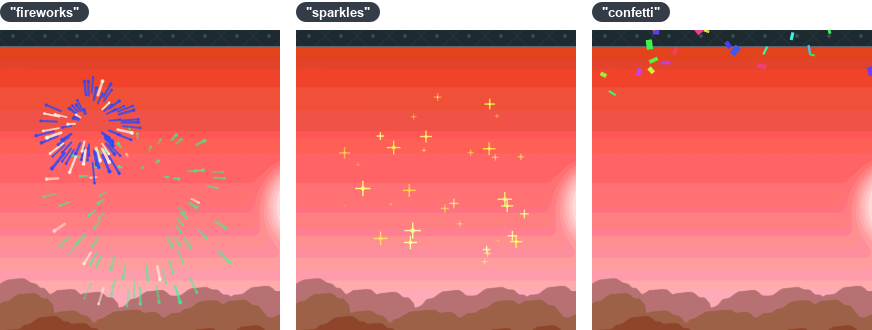
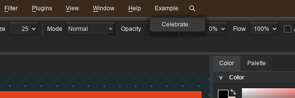
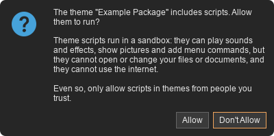
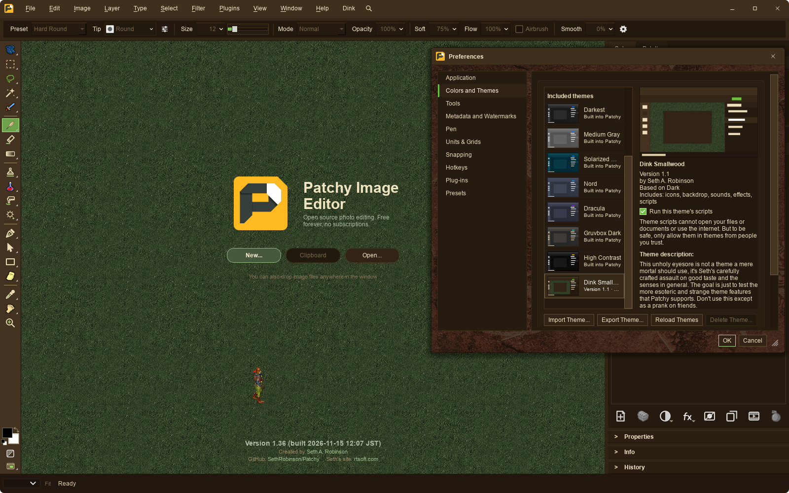

# Theme sounds, effects and scripts

The third page of [Making a Patchy theme](making-themes.md). It assumes you have a theme folder with a `theme.json`, as built on the first page; the settings shown here go in that file. The [theme reference](making-themes-advanced.md) covers everything else.

- [Events](#events)
- [Sounds](#sounds)
- [Effects](#effects)
- [Theme scripts](#theme-scripts)
- [What users see: the script question](#what-users-see-the-script-question)
- [When something does not work](#when-something-does-not-work)
- [A full example: Dink Smallwood](#a-full-example-dink-smallwood)

## Events

Patchy has no sounds of its own. A theme adds them, and effects and script reactions, by naming events: things that happen while Patchy is used.

| Event | Happens when |
| --- | --- |
| `startup` | Patchy has started and its window is up |
| `save-done` | A save or a saved copy finishes |
| `export-done` | An export finishes (Export As, Quick Export, Export for Web and the others) |
| `long-operation-done` | A progress window that was up for 3 seconds or more closes |
| `error`, `warning` | An error or a warning box opens |
| `script-alert` | A user script shows a message box |
| `document-new` | New Document creates a document |
| `document-opened` | A file opens |
| `document-closed` | A document tab closes |
| `layer-deleted` | Delete Layer removes layers |
| `undo`, `redo` | An Undo or Redo step is applied |
| `tool-changed` | The active tool changes |
| `stroke-start`, `stroke-end` | A stroke of a painting tool begins and ends |
| `idle` | Every 12 seconds while the empty Home Screen shows |

The names are fixed; use them exactly as written.

## Sounds

The short way to give an event a sound: put a WAV file named after the event in the package's `sounds` folder.

```text
My First Theme/
  theme.json
  sounds/
    save-done.wav
    startup.wav
```

That is all. Save a document and `save-done.wav` plays. `startup.wav` plays when Patchy starts with your theme, and also when someone clicks your theme in the Preferences list, so they hear it while choosing.

The long way names any WAV file in the package from `theme.json`, and can add an effect to the same event:

```json
  "events": {
    "layer-deleted": { "sound": "sounds/fx/pop.wav" },
    "document-new": { "sound": "sounds/fx/chime.wav", "effect": "sparkles" }
  }
```

When an event has both, the `"events"` sound is the one that plays.

Rules for sound files:

- **WAV only**, uncompressed (PCM). 16-bit files, mono or stereo, at 22,050 or 44,100 Hz are the safe choice. MP3, OGG and other formats are not played.
- A file directly in `sounds` must be named after an event. Any other WAV (one an `"events"` entry or a script names) goes in a subfolder, such as `sounds/fx/pop.wav`. This is how Patchy catches a misspelled event name: `sounds/savedone.wav` is left out rather than silently never played.
- Keep them short and quiet. A sound that plays on every undo gets old fast.
- On Linux, playback needs one of `paplay`, `pw-play` or `aplay`, which most desktops have.

Users can turn all theme sounds off with **Play theme sounds** on the Colors and Themes page.

### A sound that lasts as long as a brush stroke

Scripts have a second sound channel that repeats one sound until told to stop, meant for the two stroke events. See [startLoop](#sounds-from-a-script).

## Effects

An effect is a short animation drawn over the document area. It never touches the document. Four are built in:



| Effect | What it does | Options |
| --- | --- | --- |
| `fireworks` | Bursts of colored sparks | `bursts` (1 to 8, default 4) |
| `sparkles` | Twinkling stars around a point | `count` (1 to 200, default 48), `radius` in pixels |
| `confetti` | Paper falling from the top | `count` (1 to 400, default 140) |
| `sprite` | Your own animation from a picture | see below |

In `"events"`, `"effect"` is either a name or an object with options:

```json
  "events": {
    "document-opened": { "effect": "fireworks" },
    "layer-deleted": {
      "sound": "sounds/fx/pop.wav",
      "effect": { "name": "fireworks", "bursts": 1, "duration": 1200 }
    }
  }
```

Every effect also takes:

- `x` and `y`: where it happens, as fractions of the document area from the top left. The default is `0.5`, `0.4`.
- `duration`: how long it lasts in milliseconds, 100 to 10000. The default is 2000, and 2600 for confetti.

### Sprites

A sprite plays frames from a picture in your package. Put the frames side by side in one PNG (or in rows, left to right, top to bottom):

```json
  "events": {
    "idle": {
      "effect": {
        "name": "sprite",
        "image": "images/walk.png",
        "frames": 8, "frameWidth": 78, "frameHeight": 76,
        "fps": 9,
        "x": -0.05, "y": 0.84, "toX": 1.05, "toY": 0.84,
        "duration": 9000,
        "where": "start-screen"
      }
    }
  }
```

| Option | Meaning |
| --- | --- |
| `image` | The picture holding the frames |
| `frames` | How many frames it holds (up to 256) |
| `frameWidth`, `frameHeight` | The size of one frame in pixels |
| `fps` | Frames per second, 1 to 60 (default 10) |
| `loop` | `true` (default) repeats the frames for the whole duration; `false` plays them once |
| `scale` | Size, 0.1 to 8 (default 1) |
| `flip` | `true` mirrors it left to right |
| `toX`, `toY` | Where it moves to over the duration; with `x`, `y` this makes it walk across |
| `where` | `"start-screen"`: play only over the empty Home Screen and stop when a document opens |

The sprite is drawn standing on its position: `x`, `y` is the middle of its bottom edge.

Users can turn effects off with **Play theme effects**. At most 8 effects play at once.

## Theme scripts

A script lets a theme decide what to do: play one of several sounds, react to which tool is active, add a menu with commands. It is a JavaScript file named `main.js` in the package's `scripts` folder. Other files in `scripts` are not run.

This is the whole script of the [example package](../themes/example-package/scripts/main.js):

```js
patchy.theme.addCommand({ id: 'celebrate', title: 'Celebrate' }, function () {
  patchy.theme.playEffect('fireworks');
  patchy.theme.playSound('sounds/save-done.wav');
});
```

It adds a menu to the right of Help, named by `"menuTitle"` in `theme.json` (the theme's name when that is left out), with one command:



### What a script can and cannot do

A theme script runs in a small sandbox of its own, separate from Patchy's user scripting. It can play the package's sounds, show effects, show a message in the status bar, add menu commands, and set the pictures a theme may set (cursors, panel backgrounds, a splash).

It cannot open, read or change documents or files, cannot use the internet, and cannot start programs. Every path it names is inside the theme package. It has plain JavaScript, `patchy.theme`, the timer functions (`setTimeout`, `setInterval`, `clearTimeout`, `clearInterval`) and `console.log`.

### Reacting to events

```js
patchy.theme.on('document-opened', function (info) {
  if (info.width >= 4000) {
    patchy.theme.showStatus('That is a big one.');
  }
});

patchy.theme.on('tool-changed', function (info) {
  if (info.tool === 'eraser') {
    patchy.theme.playSound('sounds/fx/eraser.wav');
  }
});
```

`on(event, function)` takes any event from the [table above](#events). An unknown name is an error, which is how a script can tell an older Patchy does not have an event yet (wrap the call in `try`). Some events hand the function a little information:

| Event | Information |
| --- | --- |
| `document-opened` | `width`, `height` in pixels |
| `layer-deleted` | `count`, the number of layers removed |
| `tool-changed` | `tool`, the new tool's name (`brush`, `crop`, `type`, ... the names listed under [cursors](making-themes-advanced.md#panel-backgrounds-cursors-and-a-splash-picture)) |
| `stroke-start`, `stroke-end` | `tool`, the painting tool's name |

### Sounds from a script

```js
patchy.theme.playSound('sounds/fx/pop.wav');
```

plays a WAV from the package.

```js
patchy.theme.on('stroke-start', function () {
  patchy.theme.startLoop('sounds/strokes/brush-loop.wav', 'sounds/strokes/brush-start.wav');
});
patchy.theme.on('stroke-end', function () {
  patchy.theme.stopLoop('sounds/strokes/brush-end.wav');
});
```

`startLoop(loop, intro)` plays `intro` once (optional), then repeats `loop` without a gap until `stopLoop`, the next `startLoop`, a theme change, or two minutes. `stopLoop(outro)` stops it and plays `outro` once (optional). One loop plays at a time, and `playSound` plays over it. The loop and the intro must be WAV files of the same format, the loop at least 50 milliseconds long. Looping works on Windows and macOS; on Linux only the intro plays.

### Effects and messages

```js
patchy.theme.playEffect('confetti');
patchy.theme.playEffect('fireworks', { bursts: 6, y: 0.3 });
patchy.theme.playEffect({ name: 'sprite', image: 'images/walk.png', frames: 8,
                          frameWidth: 78, frameHeight: 76, toX: 1.05, duration: 9000 });
patchy.theme.showStatus('Level up!', 5000);
```

`playEffect` takes the same names and options as `"effect"` in `theme.json`. `showStatus(text, ms)` shows a message in the status bar for 1 to 10 seconds (default 4).

### Menu commands

```js
patchy.theme.addCommand({ id: 'party', title: 'Start a Party', hotkey: 'Ctrl+Alt+Shift+P' }, function () {
  patchy.theme.playEffect('confetti');
});
```

- `id` is a short name of your own, made of letters, digits, `-` and `_`. Keep it the same between versions of your theme: the user's own shortcut for the command is stored under it.
- `title` is the text in the menu.
- `hotkey` is optional. If Patchy already uses that key, Patchy's command keeps it. Users can change the key on the Hotkeys page of Preferences, where your commands are listed under the menu's title.
- A theme can add up to 32 commands. The menu shows only while the theme has commands.

### Pictures

```js
patchy.theme.setToolCursor('crop', 'images/sword-cursor.png', 2, 2);
patchy.theme.setPanelBackground('layers', 'images/paper.jpg', 'tile', 0.25);
patchy.theme.showSplash('images/splash.png', 1600);
```

These do from a script what `"cursors"`, `"panelBackgrounds"` and `"splash"` do in `theme.json` ([reference](making-themes-advanced.md#panel-backgrounds-cursors-and-a-splash-picture)), so a script can change them while Patchy runs. An empty picture name puts Patchy's own back. If the picture never changes, prefer `theme.json`: it works even for users who do not allow scripts.

### Timers

```js
var timer = setInterval(function () { patchy.theme.playEffect('sparkles'); }, 60000);
setTimeout(function () { clearInterval(timer); }, 600000);
```

A theme can have 16 timers. A repeating timer runs no faster than every 30 milliseconds.

### The theme itself

`patchy.theme.id` is the theme's folder or zip name and `patchy.theme.name` its display name.

`patchy.theme.log(...)` and `console.log(...)` write to Patchy's internal log, which has no window. While you are working on a script, `showStatus` is the practical way to look at a value.

### Limits on scripts

A theme script must never slow Patchy down, so Patchy holds it to a budget:

- Each call into your script (an event, a command, a timer) may take 250 milliseconds; the first run of `main.js` may take 500. A call that takes longer is cut off. After the third, the theme's scripts are turned off until the theme is applied again.
- All of the theme's script time together may be 1 second in any 3 seconds.
- Per second, a script can start 4 sounds, 4 effects and 4 status messages, change 8 cursors and 4 panel backgrounds, and make 8 `startLoop` and `stopLoop` calls. A splash can show once every 5 seconds. Calls past a limit do nothing and return `false`.
- When a script has an error, the status bar says "Theme script error:" with the message.

The declarations for editors that understand them are in [scripts/bundled/patchy-theme.d.ts](../scripts/bundled/patchy-theme.d.ts).

## What users see: the script question

Scripts do not run until the user allows them, theme by theme. The first time a theme with a script is applied or imported, Patchy asks:



"Don't Allow" is the default. A theme that is not allowed still shows everything else: colors, icons, the backdrop, event sounds and effects, cursors, panel backgrounds and the splash. Only `main.js` stays off. So build your theme to work without its script, and use the script for extras.

The answer is kept for that theme and that exact script. If the script changes, Patchy asks again. This also happens while you write one: each time you save `main.js`, the question comes back. Click **Allow** and carry on.

Users can change their answer at any time with **Run this theme's scripts** in the theme's details on the Colors and Themes page.

## When something does not work

**A sound does not play.**

- **Play theme sounds** is off, or the computer's sound is.
- The file is not an uncompressed WAV. Convert it with an audio editor such as Audacity (Export > WAV, signed 16-bit PCM).
- The file in `sounds` is not named exactly after an event, or the path in `"events"` does not match the file.
- The event name in `"events"` is misspelled. Patchy skips an event it does not know.

For the last three, the theme's details in Preferences name the file or the event under **Problems found** ([Troubleshooting](making-themes-advanced.md#troubleshooting)).

**An effect does not show.** **Play theme effects** is off, the effect name is not one of the four, or a sprite's `image` is not in the package (**Problems found** names either mistake). A `"start-screen"` sprite plays only while no document is open.

**The script does nothing.**

- It is not allowed: check **Run this theme's scripts** in the theme's details.
- The file is not `scripts/main.js`.
- It has an error. Watch the status bar when the theme is applied: "Theme script error:" shows the first one.
- The menu is missing: a menu shows only after `addCommand` ran without an error.

For everything else, see [Troubleshooting](making-themes-advanced.md#troubleshooting) on the reference page.

## A full example: Dink Smallwood

Patchy comes with one theme that uses every feature on these pages, on purpose: **Dink Smallwood**, under Included themes. Select it to see and hear what a theme can do.



Its files are in the repository: [themes/bundled/dink-smallwood](../themes/bundled/dink-smallwood). Read them next to this guide:

| File | Shows |
| --- | --- |
| [theme.json](../themes/bundled/dink-smallwood/theme.json) | About 150 roles for a complete recoloring, a tiled `backdrop`, `panelBackgrounds` for dialogs, a `cursors` entry for Crop, and `events` that pair a sound with fireworks |
| `icons/` | SVG, PNG with `@2x`, and BMP icons side by side |
| `sounds/` | One WAV per event in the short form, and `sounds/fx/` and `sounds/strokes/` for the files the script and `events` name |
| [scripts/main.js](../themes/bundled/dink-smallwood/scripts/main.js) | A splash at startup, a sprite that walks across the Home Screen on `idle`, looping brush sounds on `stroke-start` and `stroke-end`, and five menu commands |
| [README.txt](../themes/bundled/dink-smallwood/README.txt) | Where every picture and sound came from: a good habit for any theme you share |

To get the same files on your own computer, select Dink Smallwood in Preferences, click **Export Theme Package** and unzip the result. The exported `theme.json` holds the same settings as the one in the repository, with every role written out ([Sharing a theme](making-themes-advanced.md#sharing-a-theme)).

The art and sounds in that theme belong to Dink Smallwood and are there under its own license, so make your own for a theme you share.
