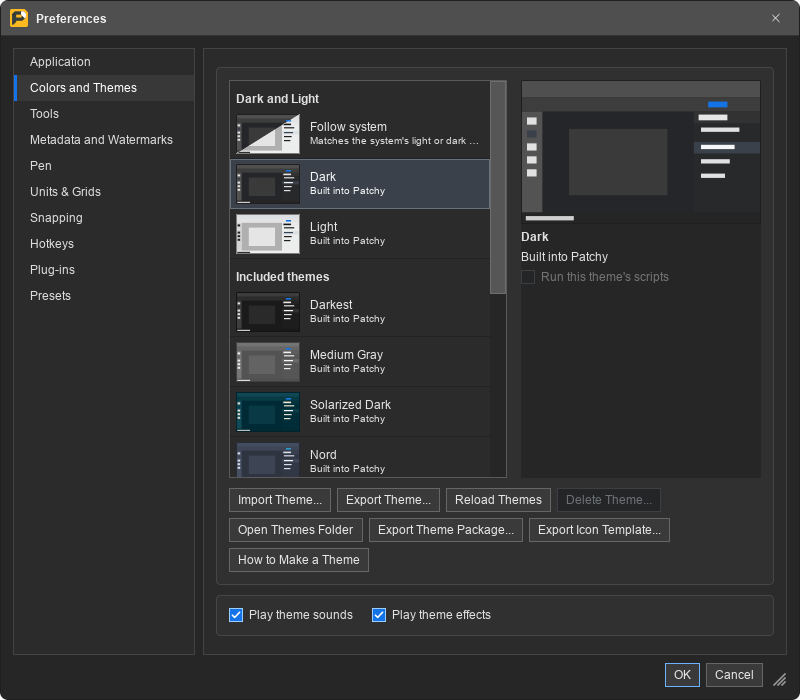
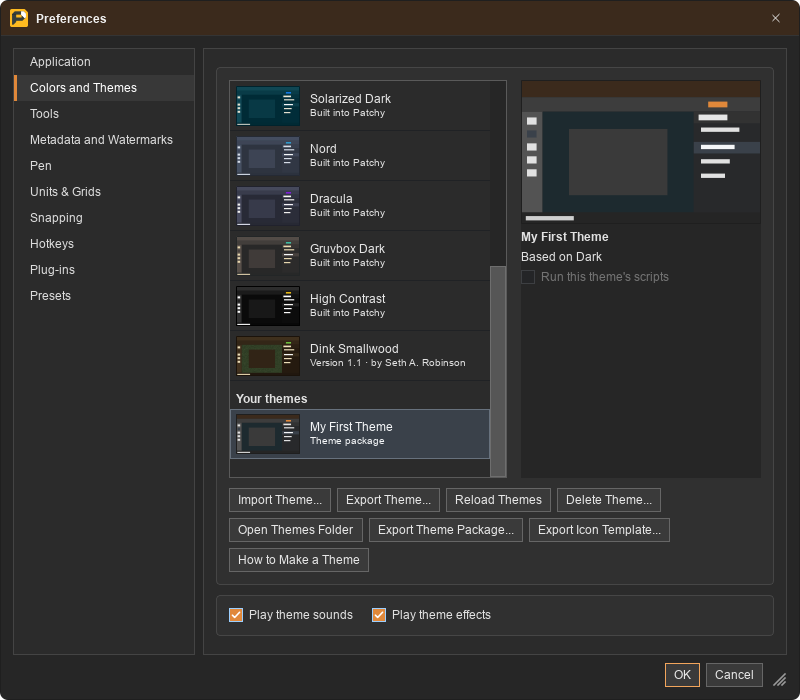
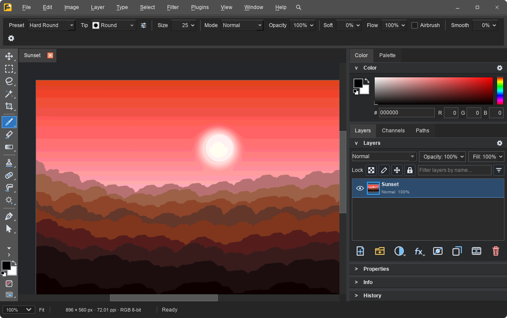
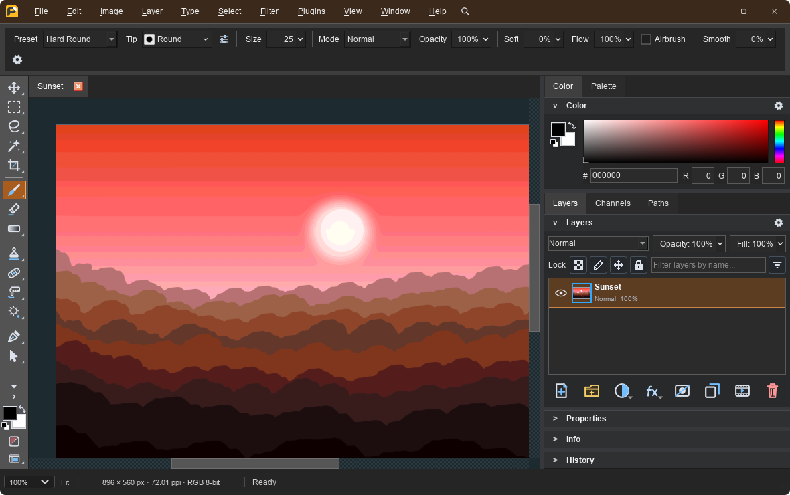
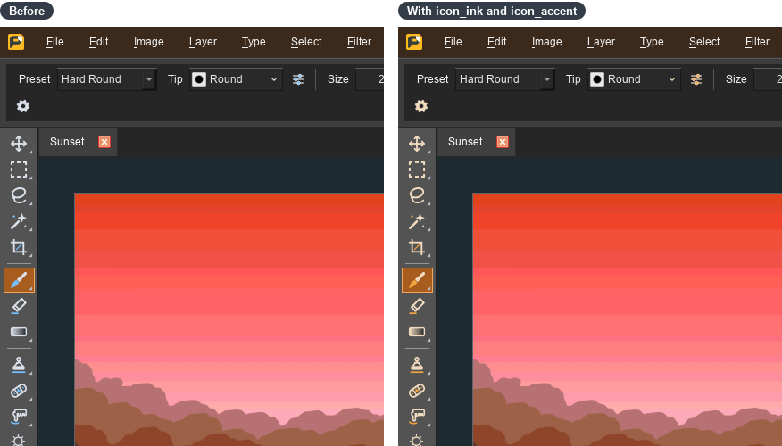
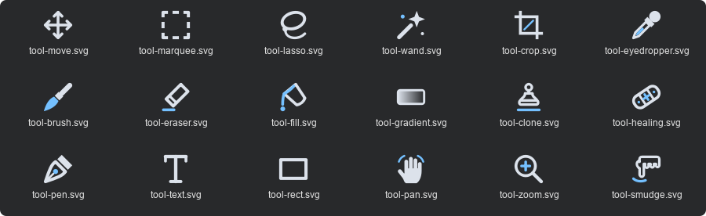
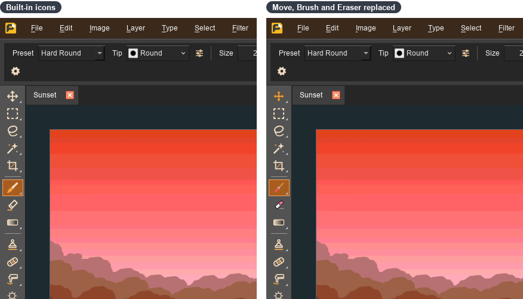
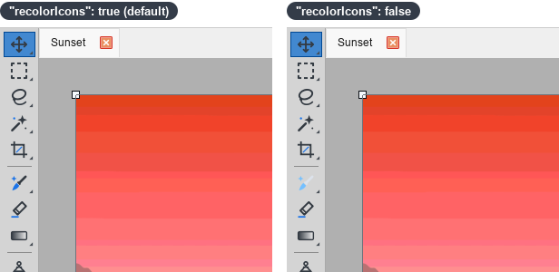
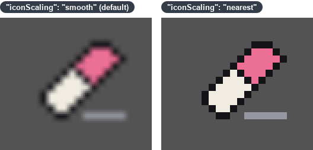

# Making a Patchy theme

A theme changes how Patchy looks and sounds: its colors, its icons, a picture behind the canvas, sounds and small animations for events such as a finished save, and even a menu of its own. You make one with a text editor and, for icons, any drawing program. Nothing needs to be compiled or installed.

This guide has three pages:

1. **Your first theme** (this page): change a few colors, recolor the icons, then replace some icons with your own.
2. [Theme reference](making-themes-advanced.md): every setting in `theme.json`, icons in depth, the backdrop, panel backgrounds, cursors, sharing a theme, and what to check when something does not show.
3. [Sounds, effects and scripts](making-themes-sounds-scripts.md): event sounds, fireworks and other effects, and theme scripts.

The theme this page builds is in the repository as [themes/example-package](../themes/example-package), and as a download: [example-package.zip](../themes/example-package.zip). Import the zip to try it, or unpack it into your themes folder to start from it.

## Where themes live

Open **Edit > Preferences** (Ctrl+K; on macOS it is in the Patchy menu) and pick **Colors and Themes**.



The list on the left holds the two built-in schemes, the themes that come with Patchy, and, once you have some, a **Your themes** section. Clicking a theme shows it at once, so you can look at it before pressing OK. Cancel puts back the theme you had.

The buttons under the list are the theme tools. This page uses three of them:

- **Open Themes Folder** opens the folder Patchy reads your themes from. On Windows it is `%APPDATA%\RTsoft\Patchy\themes`.
- **Reload Themes** reads that folder again.
- **Export Icon Template** writes every icon a theme can replace into a folder you choose.

**How to Make a Theme** opens this guide.

## Step 1: make the theme folder

A theme is a folder inside the themes folder, holding a text file named `theme.json`.

1. Click **Open Themes Folder**.
2. Make a new folder in it. Its name is up to you; this guide uses `My First Theme`.
3. In that folder, make a text file named `theme.json` with this in it:

```json
{
  "name": "My First Theme",
  "base": "dark",
  "roles": {
    "accent": "#e0883a",
    "accent_pressed_bg": "#a85d1f",
    "accent_border_bright": "#f2a55c",
    "accent_checked_bg": "#a85d1f",
    "accent_checked_border": "#f2a55c",
    "layer_row_selected_bg": "#5c3d22",
    "layer_row_selected_border": "#c98545",
    "title_bar_bg": "#3b2a1c",
    "canvas_backdrop": "#1d2a2f",
    "canvas_scrollbar_track": "#1d2a2f"
  }
}
```

- `"name"` is what the theme list shows.
- `"base"` is `"dark"` or `"light"`: the built-in scheme your theme starts from. Every color you do not set keeps that scheme's value, so a theme can be as small as this one.
- `"roles"` holds the colors you change. Each one is a name Patchy knows (a "role") and a color written as `#RRGGBB`.

The first seven turn Patchy's blue highlight orange in the places you see most: `accent` (sliders, check marks, the marker of the selected page), `accent_pressed_bg` and `accent_border_bright` (the selected tool's button), `accent_checked_bg` and `accent_checked_border` (switched-on buttons in the options bar), and `layer_row_selected_bg` and `layer_row_selected_border` (the selected layer). The last three color the title bar and the area around the document.

Save the file as plain text. Windows Notepad is fine: choose "All files" as the type so the name does not end in `.txt`.

## Step 2: select it

Back in Preferences, click **Reload Themes**. Your theme appears under **Your themes** at the end of the list. Click it.



The whole window changes as soon as you click:

| Before (Dark) | After (My First Theme) |
| --- | --- |
|  |  |

Press **OK** to keep the theme.

From here on you do not need Reload Themes for this theme. While a theme folder is the one showing, Patchy watches it: save `theme.json`, or add or change a file in the folder, and the window updates within a moment. Keep Patchy and your editor side by side and try a few colors.

If the theme is greyed out in the list and says "Could not be loaded", `theme.json` has a mistake. Point at the row to read what Patchy found. [Troubleshooting](making-themes-advanced.md#troubleshooting) lists the usual causes.

## Step 3: find the color you want to change

Patchy has about 360 roles, one for each kind of surface, border and text. You do not have to guess their names:

1. In Preferences, select the theme you want to start from (Dark, Light or any other).
2. Click **Export Theme**. Patchy offers to save a `.patchytheme` file in your themes folder.
3. Open that file in a text editor. It lists every role with the color it has now.

Copy the lines you want into the `"roles"` of your own `theme.json` and change their colors. The names say what they color: `window_bg`, `panel_bg`, `menu_bg`, `text_primary`, `title_bar_bg`, `layer_row_selected_bg`, `status_bar_bg`. [The roles most themes change](making-themes-advanced.md#the-roles-most-themes-change) has a short list to begin with.

A `.patchytheme` file is a theme too: the same text as `theme.json`, as one file, for themes that only change colors. Saved in the themes folder, the exported file shows in the list as a theme of its own; remove it with **Delete Theme** when you are done with it. Icons, pictures and sounds need a folder.

## Step 4: recolor the icons

Patchy's icons are drawn in a few shared colors, and each of those is a role. Two of them cover almost every icon:

- `icon_ink` is the main line color.
- `icon_accent` is the highlight color (the brush tip, the blue parts).

Add them to `"roles"`:

```json
    "icon_ink": "#f1dcc0",
    "icon_accent": "#f2a341"
```



Every built-in icon follows, in the tool palette, the options bar, the panels and the menus. For many themes this is all the icon work there is. The other icon colors are listed under [Icon colors](making-themes-advanced.md#icon-colors).

## Step 5: replace icons with your own

To change the drawings themselves, give your theme an `icons` folder.

1. In Preferences, click **Export Icon Template** and pick an empty folder somewhere outside the themes folder. Patchy writes each icon a theme can replace as an SVG file.

   

2. Make a folder named `icons` inside your theme folder.
3. Put your own picture in it under the same file name as the icon it replaces. The Brush tool's icon is `tool-brush.svg`, the Move tool's is `tool-move.svg`, and so on.

```text
My First Theme/
  theme.json
  icons/
    tool-brush.svg
    tool-move.svg
    tool-eraser.png
```

The names are what matter. You can edit a template file in a drawing program such as Inkscape, draw a new one, or use an icon from a free icon set whose license allows it, as long as it is saved under the template's name. Only the icons you put in the folder change; the rest stay Patchy's.



### SVG, PNG and BMP

An icon can be an SVG, a PNG or a BMP file.

- **SVG** stays sharp at every size and is the best choice for drawn icons. The templates use a 32 by 32 `viewBox`.
- **PNG** and **BMP** suit pixel art and painted icons. For sharp icons on high-resolution screens, add a second file at twice the size with `@2x` before the extension: `tool-eraser.png` at 16 by 16 and `tool-eraser@2x.png` at 32 by 32.

### Icons with their own colors

Patchy does not touch most colors in your SVG files. It swaps only the ten template colors (`#dce2eb`, `#74c0ff` and eight more) for the theme's icon roles, which is what keeps an edited template icon readable on a light theme.

If your icons use those exact colors and you want them left as drawn, turn the swap off in `theme.json`:

```json
  "recolorIcons": false,
```



Both pictures show one Brush icon, drawn in the template's pale gray and blue, in a theme based on Light. With the swap on, Patchy draws it in the light scheme's dark ink. With the swap off it stays pale and nearly disappears.

PNG and BMP icons are never recolored.

### Pixel art

Patchy scales a PNG or BMP icon smoothly to the size it needs. For pixel art, ask for hard edges instead:

```json
  "iconScaling": "nearest",
```



## The finished theme

With all five steps, `theme.json` reads:

```json
{
  "name": "My First Theme",
  "base": "dark",
  "recolorIcons": false,
  "iconScaling": "nearest",
  "roles": {
    "accent": "#e0883a",
    "accent_pressed_bg": "#a85d1f",
    "accent_border_bright": "#f2a55c",
    "accent_checked_bg": "#a85d1f",
    "accent_checked_border": "#f2a55c",
    "layer_row_selected_bg": "#5c3d22",
    "layer_row_selected_border": "#c98545",
    "title_bar_bg": "#3b2a1c",
    "canvas_backdrop": "#1d2a2f",
    "canvas_scrollbar_track": "#1d2a2f",
    "icon_ink": "#f1dcc0",
    "icon_accent": "#f2a341"
  }
}
```

The [example package](../themes/example-package) is this theme with a few things added: a version, an author and a description for the theme list, a tiled picture behind the canvas, a sound when a save finishes, sparkles when a new document opens, and a one-command script. The other two pages explain each of them.

## Sharing your theme

Zip the theme folder and send the zip. Whoever gets it clicks **Import Theme** in Preferences and picks the file; Patchy copies it into their themes folder and selects it. [Sharing a theme](making-themes-advanced.md#sharing-a-theme) has the details.

## Next

- [Theme reference](making-themes-advanced.md): all of `theme.json`, the backdrop, panel backgrounds, cursors, limits and troubleshooting.
- [Sounds, effects and scripts](making-themes-sounds-scripts.md).
